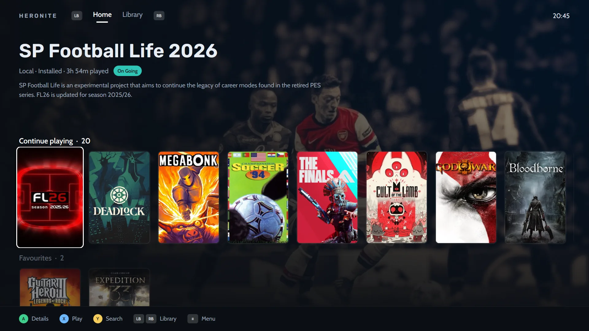

Playnite and Heronite solve the same problem. Your games live in many places, and you want one library for all of them. The big difference is the system they run on.

**In short:** pick Playnite if you play on Windows and want its mature library and add-on ecosystem. Pick Heronite if you play on Linux, or on both Linux and Windows and want the same launcher on each. This page is current as of November 2026.

## At a glance

| | Heronite | Playnite |
|---|---|---|
| Platforms | Linux and Windows 10/11 | Windows 10/11 |
| License | GPL-3.0, open source | MIT, open source |
| Built with | Rust, GPU-rendered, no bundled browser | C# and WPF |
| Steam library | Yes, no login needed | Yes |
| Epic and GOG | Yes | Yes |
| Battle.net, EA app, Ubisoft Connect | Linux only, each store's own app runs in a Wine prefix | Yes |
| Emulation | Yes | Yes |
| Play time tracking | Yes, with statistics and a journal | Yes |
| Controller / couch mode | Yes, console mode with themes | Yes, fullscreen mode |
| Plugins and scripts | No | Yes |
| Themes | Console mode themes | Yes |
| Runs Windows games on Linux | Yes, through Wine or Proton | Not applicable, it runs on Windows only |

The Playnite column comes from [playnite.link](https://playnite.link) and the [Playnite repository](https://github.com/JosefNemec/Playnite).

## Is there a Playnite for Linux?

Not yet. Playnite's README lists Windows 10 or 11 as its requirement, and it is built on WPF, which is a Windows framework.

The developer has talked about Linux for years. In [a GitHub discussion](https://github.com/JosefNemec/Playnite/issues/59) he wrote in November 2025 that he planned to move to Linux in 2026, after Playnite 11 is done, and to try to build a Linux version. He expects it to be less complete than the Windows one, but usable every day with Wine and Proton integration. The README says Playnite is being rewritten from scratch for version 11.

We found no released Linux version as of November 2026. If one arrives, good: more choice is better for everyone. Until then, Heronite is a launcher you can install on Linux today.

## What both do well

Both are free and open source. Both pull your games from several stores into one library, record how long you play, support emulators and have a controller-friendly full-screen mode. If you only look at the feature list, they are closer than they are different.

## Where Heronite differs

### It runs on Linux and Windows

Heronite is one native app for both systems. On Linux it launches Windows games through Wine or Proton, with a version and prefix you can set per game and a [Wine Manager](/features/wine-and-proton/) to download builds such as Proton-CachyOS and GE-Proton. On Windows it runs the games directly. Your Collection, views and habits look the same on both.

### It stays light

Heronite is a single Rust process drawn on the GPU, with no browser engine inside. It uses about 190 MB of memory when idle (about 95 MB when closed to the tray), around 0.1% CPU, and starts to the library in about 215 ms. The install is 64 MB. See [performance](/features/performance/) for how we measured it.

### Your play history is a feature

Heronite records every session. You get [statistics](/features/play-time-tracking/) by week, month and year, a yearly backlog goal, a journal for notes next to your screenshots, and a year in review. Playnite tracks play time as well. Heronite puts more of its design into looking back at what you played.

### Console mode with themes

[Console mode](/features/console-mode/) is a controller-first layout for the couch or a TV. It has eight layouts and seven built-in themes, and you can change colours, fonts and menus, then export a theme as a file to share.

*Console mode home: a featured game and a shelf to continue playing.*

### Emulators and ROMs

Heronite [detects the emulators](/features/emulation/) you have installed, including RetroArch with its cores, Dolphin, PCSX2, DuckStation, PPSSPP, RPCS3, Cemu and mGBA, and scans your ROM folders on both Linux and Windows. Each ROM becomes a game with its own cover and play time, and you can continue from a save state on the game's page. You can also connect a RetroAchievements account to see achievements for emulated games. Playnite supports emulators too, and its site describes a range of console emulators. If you already have a tuned emulator setup there, compare before you move it.

### More stores on Linux

On Linux, Heronite installs the Battle.net, EA app, Ubisoft Connect and Rockstar Games clients in their own Wine prefixes. The games you install there show up in the same Collection. On Windows, Heronite covers Steam, Epic, GOG and Amazon, and uses the other stores' own apps.

## Where Playnite is stronger

- **Add-ons.** Playnite is extensible through plugins, scripts and themes. If you want to reshape the launcher, it offers far more room than Heronite does.
- **Track record on Windows.** Playnite has a long public history: its developer was already discussing Linux in 2017. Heronite is younger.
- **Many library sources.** Playnite's site lists Steam, Epic, GOG, Battle.net, Ubisoft Connect and others as libraries it connects, and its repository also mentions the EA app. On Windows, Heronite handles Steam, Epic, GOG and Amazon.
- **Windows-first depth.** If you never leave Windows, nothing in Heronite is a reason to give up a setup you like.

## When to choose Playnite

- You play on Windows only and are happy with it.
- You rely on plugins, scripts or a community theme.
- You want Battle.net, Ubisoft Connect or EA app games imported straight into the launcher on Windows.
- You have a large library you have already tuned in Playnite, and no wish to start again.

## When to choose Heronite

- You use Linux, or you dual boot and want one launcher on both systems.
- You want Windows games to run through Wine or Proton from the same app that lists them.
- You like a light app with no bundled browser.
- You want play statistics, a journal and a backlog goal.
- You want to import games from Heroic, Lutris, Bottles or Faugus on Linux.

## Switching from Playnite

Heronite has no Playnite importer, so there is no one-click move. Here is what happens in practice:

1. **Stores come back by themselves.** Heronite reads your Steam libraries with no login. Log in to Epic Games, GOG and Amazon Games on the **Stores** page and those whole libraries join the Collection. On Windows, games already installed by the Epic Games Launcher, GOG Galaxy or the Amazon Games app come in without downloading again. For Epic games you never played in Heronite, Heronite can also take in the play time Epic recorded.
2. **Games you added by hand** need adding again. Press `Ctrl+N` to add a program, or point at a folder and add every game found in it at once.
3. **Emulated games** return when Heronite [detects your emulators](/features/emulation/) and scans your ROM folders.
4. **Playnite's own data does not move over.** Tags, completion status, notes and Playnite's play time stay in Playnite, which keeps working as before. Heronite does not touch its files.

> **Note.** You can run both side by side on Windows while you decide. Neither one changes the other's data.

## Try it

Heronite is free, with no account, ads or telemetry. [Download it](/download/) for Linux or Windows, then read [Getting started](/docs/getting-started/) and the [FAQ](/docs/faq/). To see how it works with every store, read about [stores and launchers](/features/stores/).
