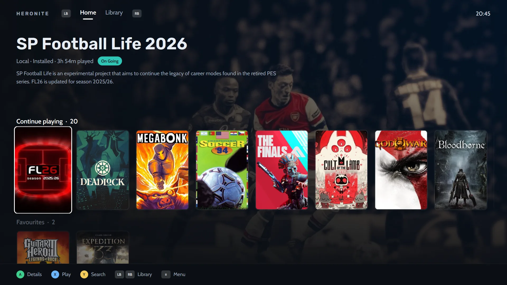

**En resumen:** elige Playnite si juegas en Windows y quieres su biblioteca madura y su ecosistema de complementos. Elige Heronite si juegas en Linux, o en Linux y Windows y quieres el mismo launcher en cada uno.

## Comparación rápida

| | Heronite | Playnite |
|---|---|---|
| Plataformas | Linux y Windows 10/11 | Windows 10/11 |
| Licencia | GPL-3.0 | MIT |
| Hecho con | Rust, dibujado en la GPU, sin navegador incluido | C# y WPF |
| Biblioteca de Steam | Sí, sin iniciar sesión | Sí |
| Epic y GOG | Sí | Sí |
| Battle.net, EA app, Ubisoft Connect | Solo en Linux, en un prefijo de Wine | Sí |
| Emulación | Sí | Sí |
| Seguimiento del tiempo de juego | Estadísticas y un diario | Sí |
| Modo consola | Sí, con temas | Sí, modo pantalla completa |
| Complementos y scripts | No | Sí |
| Temas | Temas del modo consola | Sí |
| Ejecuta juegos de Windows en Linux | Sí, con Wine o Proton | No aplica |

La columna de Playnite proviene de [playnite.link](https://playnite.link) y del [repositorio de Playnite](https://github.com/JosefNemec/Playnite). Actualizado a noviembre de 2026.

## ¿Existe Playnite para Linux?

Todavía no. El README de Playnite indica Windows 10 u 11 como requisito, y está construido sobre WPF, un framework de Windows. El README también dice que Playnite se está reescribiendo desde cero para la versión 11.

En [una discusión de GitHub](https://github.com/JosefNemec/Playnite/issues/59) de noviembre de 2025, el desarrollador escribió que planeaba dar el salto a Linux en 2026, cuando termine Playnite 11. Intentaría construir una versión para Linux, menos completa que la de Windows pero utilizable a diario con integración de Wine y Proton. No encontramos ninguna versión para Linux publicada a noviembre de 2026.

## ¿Qué tienen en común Heronite y Playnite?

Los dos son gratuitos y de código abierto. Los dos reúnen juegos de varias tiendas en una biblioteca, registran el tiempo de juego, admiten emuladores y tienen un modo de pantalla completa pensado para mandos.

## ¿Cuál debes elegir?

### Elige Playnite si…

- **Juegas solo en Windows y estás contento con él.** Nada en Heronite es motivo para dejar una configuración que te gusta.
- **Dependes de complementos, scripts o un tema de la comunidad.** Playnite se puede ampliar con complementos, scripts y temas, con mucho más margen que Heronite.
- **Quieres que los juegos de Battle.net, Ubisoft Connect o la EA app se importen directamente en Windows.** El sitio de Playnite lista Battle.net y Ubisoft Connect entre sus bibliotecas, y su repositorio menciona la EA app. En Windows, Heronite maneja Steam, Epic, GOG y Amazon.
- **Tienes una biblioteca o una configuración de emuladores que ya ajustaste.** El sitio de Playnite describe una variedad de emuladores de consolas, así que compara antes de mover la tuya.
- **Quieres una larga trayectoria.** El desarrollador de Playnite ya hablaba de Linux en 2017. Heronite es más joven.

### Elige Heronite si…

- **Usas Linux, o tienes arranque dual.** Heronite es una sola app nativa para ambos sistemas, con la misma biblioteca y las mismas vistas en cada uno. En Windows ejecuta los juegos directamente.
- **Quieres que los juegos de Windows se ejecuten con Wine o Proton desde la app que los lista.** Define una versión y un prefijo por juego. El [Gestor de Wine](/es/features/wine-and-proton/) descarga versiones como Proton-CachyOS y GE-Proton.
- **Quieres una app ligera.** Heronite es un único proceso de Rust sin motor de navegador dentro, y usa unos 190 MB de memoria en reposo. Mira el [rendimiento](/es/features/performance/).
- **Quieres un historial de juego.** Heronite registra cada sesión: [estadísticas](/es/features/play-time-tracking/) por semana, mes y año, una meta anual de backlog, un diario junto a tus capturas y un resumen del año.
- **Quieres un modo consola con temas.** El [modo consola](/es/features/console-mode/) es un diseño pensado para mandos, para el sofá o una TV, con ocho diseños y siete temas. Exporta un tema como archivo para compartirlo.
- **Juegas juegos emulados.** Heronite [detecta los emuladores](/es/features/emulation/) que tienes instalados, incluidos RetroArch con sus cores, Dolphin, PCSX2 y DuckStation, y escanea tus carpetas de ROMs en Linux y Windows. Cada ROM se convierte en un juego con su portada y su tiempo de juego, y puedes continuar desde un estado guardado o conectar una cuenta de RetroAchievements.
- **Quieres más tiendas en Linux.** Heronite instala los clientes de Battle.net, EA app, Ubisoft Connect y Rockstar Games en sus propios prefijos de Wine, y sus juegos aparecen en la misma Colección.
- **Quieres importar juegos de Heroic, Lutris, Bottles o Faugus** en Linux.

*Inicio del modo consola: un juego destacado y un estante para seguir jugando.*

## ¿Cómo cambio de Playnite a Heronite?

Heronite no tiene un importador de Playnite, así que no hay un traslado con un clic. Reconstruye tu biblioteca en tres pasos:

1. **Inicia sesión en Epic Games, GOG y Amazon Games** en la página **Tiendas**. Tus bibliotecas completas se unen a la Colección. Steam no necesita inicio de sesión.
2. **Añade de nuevo los juegos que añadiste a mano.** Pulsa <kbd>Ctrl</kbd> <kbd>N</kbd> para añadir un programa, o apunta a una carpeta para añadir de una vez todos los juegos que contenga.
3. **Detecta tus emuladores y escanea tus carpetas de ROMs.** En la página de **Emuladores** (<kbd>Ctrl</kbd> <kbd>5</kbd>), pulsa detectar y luego escanear, y tus [juegos emulados](/es/features/emulation/) vuelven.

En Windows, Heronite recoge los juegos instalados por el Epic Games Launcher, GOG Galaxy o la app de Amazon Games sin descargarlos otra vez. Para los juegos de Epic que nunca jugaste en Heronite, puede traer el tiempo de juego que Epic registró.

Las etiquetas, el estado de completado, las notas y el tiempo de juego de Playnite se quedan en Playnite, que sigue funcionando como antes. Heronite nunca toca sus archivos.

> **Nota.** Puedes usar los dos a la vez en Windows mientras decides.

**Siguiente:** [descarga Heronite](/es/download/) para Linux o Windows, luego lee [Primeros pasos](/es/docs/getting-started/).
