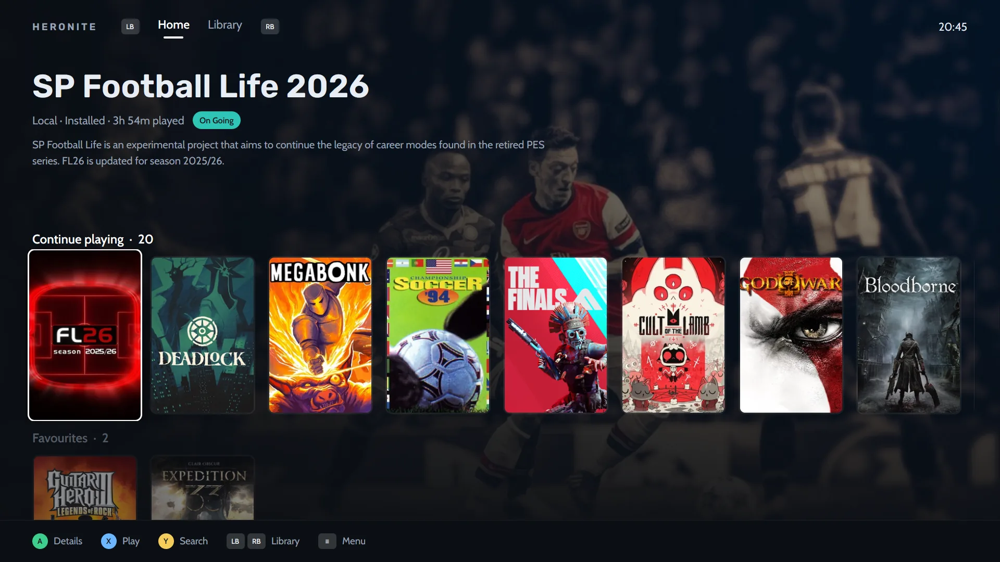

## Heronite et Playnite : comparatif des fonctionnalités

| | Heronite | Playnite |
|---|---|---|
| Systèmes | Linux et Windows 10/11 | Windows 10/11 |
| Licence | GPL-3.0 | MIT |
| Technologies | Rust, rendu GPU, sans navigateur embarqué | C# et WPF |
| Bibliothèque Steam | Oui, sans connexion | Oui |
| Epic et GOG | Oui | Oui |
| Battle.net, EA app, Ubisoft Connect | Oui, via Wine sur Linux | Oui |
| Émulation | Oui | Oui |
| Suivi du temps de jeu | Statistiques et journal | Oui |
| Mode console | Oui, avec thèmes | Oui, mode plein écran |
| Extensions et scripts | Non | Oui |
| Thèmes | Thèmes du mode console | Oui |
| Jeux Windows sur Linux | Oui, via Wine ou Proton | Sans objet |
| Import depuis l’autre lanceur | Oui, sur Windows | Sans objet |

La colonne Playnite s’appuie sur [playnite.link](https://playnite.link) et le [dépôt Playnite](https://github.com/JosefNemec/Playnite), à jour en novembre 2026.

## Playnite arrive-t-il sur Linux ?

Pas encore. Son README indique Windows 10 ou 11 ; Playnite utilise WPF, un framework Windows. Son développeur réécrit l’application pour la version 11.

Dans une [discussion GitHub](https://github.com/JosefNemec/Playnite/issues/59) de novembre 2025, il indiquait prévoir de passer à Linux en 2026 après Playnite 11 et de tenter une version Linux. Aucune version Linux publiée n’a été trouvée en novembre 2026.

## Quels sont leurs points communs ?

Tous deux sont gratuits et open source. Ils réunissent plusieurs boutiques dans une bibliothèque, enregistrent le temps de jeu, prennent en charge les émulateurs et proposent un mode plein écran adapté à la manette.

## Lequel choisir ?

### Choisissez Playnite si…

- **Vous dépendez d’extensions, de scripts ou d’un thème communautaire.** Playnite prend en charge les extensions, scripts PowerShell et thèmes.
- **Votre configuration d’émulation est déjà réglée.** Le site décrit plusieurs émulateurs de consoles ; comparez avant de migrer.
- **Vous préférez un projet établi depuis longtemps.** Playnite est le plus ancien.

### Choisissez Heronite si…

- **Vous utilisez Linux ou un double démarrage.** Une application native pour les deux systèmes ; **Settings → Cloud** garde la même bibliothèque sur chacun.
- **Vous voulez Wine ou Proton pour les jeux Windows.** Réglez version et préfixe Wine par jeu avec [Wine Manager](/fr/features/wine-and-proton/).
- **Vous voulez une application native Rust.** Sans navigateur embarqué, environ 190 Mo au repos ([performances](/fr/features/performance/)).
- **Vous voulez un historique de jeu.** Chaque session alimente les [statistiques](/fr/features/play-time-tracking/), un objectif annuel, un journal et un bilan.
- **Vous jouez à des jeux émulés.** Heronite [détecte les émulateurs](/fr/features/emulation/) comme RetroArch, Dolphin, PCSX2 et DuckStation et analyse vos ROM.
- **Vous voulez plus de sources sur Linux.** Applications Battle.net, EA, Ubisoft et Rockstar et imports Heroic, Lutris, Bottles et Faugus.

*Accueil du mode console : un jeu mis en avant et une rangée pour reprendre vos parties.*

## Comment passer de Playnite à Heronite ?

Sur Windows, Heronite importe les jeux installés de Playnite en lisant uniquement ses fichiers. Playnite continue de fonctionner.

1. **Connectez-vous aux boutiques.** Ouvrez **Stores** (<kbd>Ctrl</kbd> <kbd>4</kbd>) et connectez-vous à Epic Games, GOG et Amazon Games. Steam ne demande pas de connexion.
2. **Importez les jeux Playnite.** Fermez Playnite, puis activez **Bring its games in** sous Playnite dans **Settings → Other launchers**. Les jeux installés apparaissent avec jaquettes et temps de jeu, et passent toujours par Playnite.
3. **Ajoutez les autres jeux.** <kbd>Ctrl</kbd> <kbd>N</kbd> ajoute un programme ; **Add from folder** dans le menu ☰ ajoute les jeux d’un dossier.
4. **Détectez les émulateurs et analysez les ROM.** Dans **Emulators** (<kbd>Ctrl</kbd> <kbd>5</kbd>), appuyez sur **Detect emulators**, puis **Scan now**.

Heronite exclut les jeux Steam, Epic, GOG et Amazon de Playnite, car il les importe directement depuis les boutiques. Étiquettes, statuts de progression et notes restent dans Playnite.

Sur Windows, Heronite reprend les jeux installés par Epic Games Launcher, GOG Galaxy ou Amazon Games sans les télécharger à nouveau. Pour les jeux Epic jamais lancés dans Heronite, il peut reprendre le temps enregistré par Epic.

**À lire ensuite :** [téléchargez Heronite](/fr/download/) pour Linux ou Windows, puis consultez [Premiers pas](/fr/docs/getting-started/).
