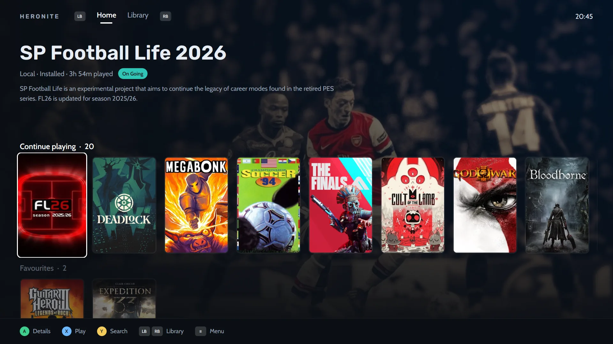

O Playnite e o Heronite resolvem o mesmo problema. Seus jogos estão espalhados por vários lugares, e você quer uma biblioteca só para todos eles. A grande diferença é o sistema em que cada um roda.

**Resumindo:** escolha o Playnite se você joga no Windows e quer a biblioteca madura e o ecossistema de extensões dele. Escolha o Heronite se você joga no Linux, ou nos dois, Linux e Windows, e quer o mesmo launcher em cada um. Esta página está atualizada até novembro de 2026.

## Comparação rápida

| | Heronite | Playnite |
|---|---|---|
| Plataformas | Linux e Windows 10/11 | Windows 10/11 |
| Licença | GPL-3.0, código aberto | MIT, código aberto |
| Feito com | Rust, renderizado pela GPU, sem navegador embutido | C# e WPF |
| Biblioteca da Steam | Sim, sem login | Sim |
| Epic e GOG | Sim | Sim |
| Battle.net, EA app, Ubisoft Connect | Só no Linux, o app de cada loja roda num prefixo Wine | Sim |
| Emulação | Sim | Sim |
| Controle do tempo de jogo | Sim, com estatísticas e diário | Sim |
| Modo controle / sofá | Sim, modo console com temas | Sim, modo tela cheia |
| Plugins e scripts | Não | Sim |
| Temas | Temas do modo console | Sim |
| Roda jogos de Windows no Linux | Sim, pelo Wine ou pelo Proton | Não se aplica, ele roda só no Windows |

A coluna do Playnite vem do [playnite.link](https://playnite.link) e do [repositório do Playnite](https://github.com/JosefNemec/Playnite).

## Existe Playnite para Linux?

Ainda não. O README do Playnite lista o Windows 10 ou 11 como requisito, e ele é feito em WPF, que é um framework do Windows.

O desenvolvedor fala de Linux há anos. Em [uma discussão no GitHub](https://github.com/JosefNemec/Playnite/issues/59), ele escreveu em novembro de 2025 que planejava migrar para o Linux em 2026, depois que o Playnite 11 ficasse pronto, e tentar fazer uma versão para Linux. Ele espera que ela seja menos completa que a de Windows, mas usável no dia a dia, com integração ao Wine e ao Proton. O README diz que o Playnite está sendo reescrito do zero para a versão 11.

Não encontramos nenhuma versão para Linux lançada até novembro de 2026. Se ela chegar, ótimo: mais opções são melhores para todo mundo. Até lá, o Heronite é um launcher que você pode instalar hoje no Linux.

## O que os dois fazem bem

Os dois são gratuitos e de código aberto. Os dois reúnem seus jogos de várias lojas numa biblioteca só, registram quanto você joga, aceitam emuladores e têm um modo de tela cheia pensado para controle. Se você olhar só a lista de recursos, eles são mais parecidos do que diferentes.

## Onde o Heronite é diferente

### Roda no Linux e no Windows

O Heronite é um app nativo único para os dois sistemas. No Linux, ele abre jogos de Windows pelo Wine ou pelo Proton, com versão e prefixo que você define em cada jogo e um [Gerenciador do Wine](/pt-br/features/wine-and-proton/) para baixar versões como Proton-CachyOS e GE-Proton. No Windows, ele roda os jogos direto. Sua Coleção, suas visões e seus hábitos ficam iguais nos dois.

### Continua leve

O Heronite é um processo único em Rust, desenhado pela GPU, sem motor de navegador dentro. Ele usa cerca de 190 MB de memória em repouso (cerca de 95 MB quando fechado na bandeja), em torno de 0,1% de CPU, e chega à biblioteca em cerca de 215 ms. A instalação tem 64 MB. Veja [desempenho](/pt-br/features/performance/) para saber como medimos.

### Seu histórico de jogo é um recurso

O Heronite registra cada sessão. Você tem [estatísticas](/pt-br/features/play-time-tracking/) por semana, mês e ano, uma meta anual de backlog, um diário para anotações ao lado das suas capturas de tela e uma retrospectiva do ano. O Playnite também controla o tempo de jogo. O Heronite dedica mais do design dele a olhar para trás e ver o que você jogou.

### Modo console com temas

O [modo console](/pt-br/features/console-mode/) é um layout feito para o controle, para o sofá ou a TV. Ele tem oito layouts e sete temas embutidos, e você pode mudar cores, fontes e menus e depois exportar um tema como arquivo para compartilhar.

*Início do modo console: um jogo em destaque e uma prateleira para continuar jogando.*

### Emuladores e ROMs

O Heronite [detecta os emuladores](/pt-br/features/emulation/) que você tem instalados, incluindo o RetroArch com seus cores, Dolphin, PCSX2, DuckStation, PPSSPP, RPCS3, Cemu e mGBA, e escaneia suas pastas de ROMs no Linux e no Windows. Cada ROM vira um jogo com capa e tempo de jogo próprios, e você pode continuar de um save state na página do jogo. Também dá para conectar uma conta do RetroAchievements para ver as conquistas dos jogos emulados. O Playnite também aceita emuladores, e o site dele descreve uma variedade de emuladores de console. Se você já tem uma configuração de emuladores bem ajustada por lá, compare antes de migrar.

### Mais lojas no Linux

No Linux, o Heronite instala os clientes da Battle.net, EA app, Ubisoft Connect e Rockstar Games em prefixos Wine próprios. Os jogos que você instala por lá aparecem na mesma Coleção. No Windows, o Heronite cobre Steam, Epic, GOG e Amazon, e usa os apps das outras lojas.

## Onde o Playnite é mais forte

- **Extensões.** O Playnite é extensível por plugins, scripts e temas. Se você quer remodelar o launcher, ele oferece muito mais espaço que o Heronite.
- **Histórico no Windows.** O Playnite tem um longo histórico público: o desenvolvedor já discutia o Linux em 2017. O Heronite é mais novo.
- **Muitas fontes de biblioteca.** O site do Playnite lista Steam, Epic, GOG, Battle.net, Ubisoft Connect e outras como bibliotecas que ele conecta, e o repositório dele também menciona a EA app. No Windows, o Heronite cuida de Steam, Epic, GOG e Amazon.
- **Profundidade focada no Windows.** Se você nunca sai do Windows, nada no Heronite é motivo para abrir mão de uma configuração de que você gosta.

## Quando escolher o Playnite

- Você joga só no Windows e está satisfeito com ele.
- Você depende de plugins, scripts ou de um tema da comunidade.
- Você quer jogos da Battle.net, Ubisoft Connect ou EA app importados direto para o launcher no Windows.
- Você tem uma biblioteca grande que já ajustou no Playnite e não quer recomeçar.

## Quando escolher o Heronite

- Você usa Linux, ou faz dual boot e quer um launcher só nos dois sistemas.
- Você quer que os jogos de Windows rodem pelo Wine ou pelo Proton no mesmo app que os lista.
- Você gosta de um app leve, sem navegador embutido.
- Você quer estatísticas de jogo, um diário e uma meta de backlog.
- Você quer importar jogos do Heroic, Lutris, Bottles ou Faugus no Linux.

## Como migrar do Playnite

O Heronite não tem importador do Playnite, então não há migração com um clique. Veja o que acontece na prática:

1. **As lojas voltam sozinhas.** O Heronite lê suas bibliotecas da Steam sem login. Entre na Epic Games, GOG e Amazon Games na página **Lojas** e essas bibliotecas inteiras vão para a Coleção. No Windows, os jogos já instalados pela Epic Games Launcher, pelo GOG Galaxy ou pelo app da Amazon Games entram sem baixar de novo. Para jogos da Epic que você nunca jogou no Heronite, ele também pode trazer o tempo de jogo que a Epic registrou.
2. **Jogos que você adicionou à mão** precisam ser adicionados de novo. Aperte `Ctrl+N` para adicionar um programa, ou aponte uma pasta e adicione de uma vez todos os jogos encontrados nela.
3. **Jogos emulados** voltam quando o Heronite [detecta seus emuladores](/pt-br/features/emulation/) e escaneia suas pastas de ROMs.
4. **Os dados do próprio Playnite não passam para o Heronite.** Tags, status de conclusão, anotações e o tempo de jogo do Playnite ficam no Playnite, que continua funcionando como antes. O Heronite não mexe nos arquivos dele.

> **Nota.** Você pode usar os dois lado a lado no Windows enquanto decide. Nenhum muda os dados do outro.

## Experimente

O Heronite é gratuito, sem conta, sem anúncios e sem telemetria. [Baixe](/pt-br/download/) para Linux ou Windows e leia [Primeiros passos](/pt-br/docs/getting-started/) e o [FAQ](/pt-br/docs/faq/). Para ver como ele funciona com cada loja, leia sobre [lojas e launchers](/pt-br/features/stores/).
