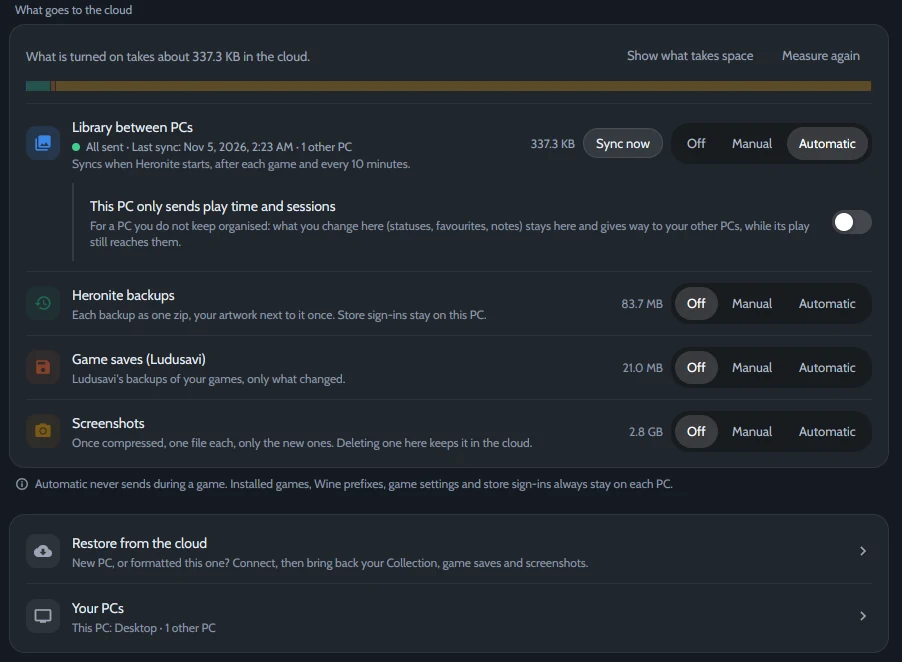

*Settings → Cloud, synced with one other PC.*

## What syncs

| Syncs | Stays on each PC |
|---|---|
| Statuses, favourites and ratings | Installed games |
| Notes and hidden games | Wine prefixes |
| Play time and sessions | Game settings and store sign-ins |

Your data goes only to the folder or account you choose.

## Choose where your PCs meet

| Service | Best for |
|---|---|
| **A shared folder** | A dual boot, or a folder that Syncthing, Dropbox or OneDrive already keep in sync |
| **Google Drive, Dropbox, OneDrive or Box** | PCs in different places. You sign in once, in the browser |
| **FTP, SMB or WebDAV** | A NAS or a home server |
| **An rclone remote** | Any other service you set up with `rclone config` |

Accounts and servers go through [rclone](https://rclone.org/). Heronite downloads it if it is not installed.

## Set it up

1. Open **Settings → Cloud**.
2. Under **Service**, choose where your PCs meet. For an account or a server, press **Connect**. For a shared folder, choose the **Sync folder**.
3. Under **Choose what goes, and when**, set **Library between PCs** to **Automatic**.
4. Do the same on your other PCs, with the same account or folder.

**Automatic** syncs when Heronite starts, after each game and every 10 minutes. **Manual** waits for **Sync now**.

## On a Linux and Windows dual boot

1. Pick a drive both systems mount at startup, formatted **NTFS** or **exFAT**, and choose a folder on it as the **Sync folder** in both systems.
2. In Windows, turn off **Fast Startup**. Otherwise Linux mounts the drive read-only.
3. Under **Your PCs**, give each side a name, like *Linux* and *Windows*.

## When two PCs disagree

Each PC writes only its own file, so a sync service never has two copies to choose between. Heronite merges them:

- **Statuses, favourites, ratings and notes:** the newest change wins, field by field.
- **Sessions:** every PC's sessions are kept, with no duplicates.
- **Play time:** the largest total wins, unless you lowered it by hand.
- **A game only one PC has:** its data waits, and comes in once you add that game on the other PC.

## More options

- **This PC only sends play time and sessions:** for a PC you don't keep organised. Its play time and sessions count everywhere; statuses, favourites, ratings, hidden games and notes come from the other PCs.
- **Backups, game saves and screenshots** can go to the same account. See [Backups and saves](/docs/backups-and-saves/).
- **New PC:** sync fills in games a PC already has. To bring the whole library from a backup another PC sent, see [Set up a new PC from the cloud](/docs/backups-and-saves/#set-up-a-new-pc-from-the-cloud).
