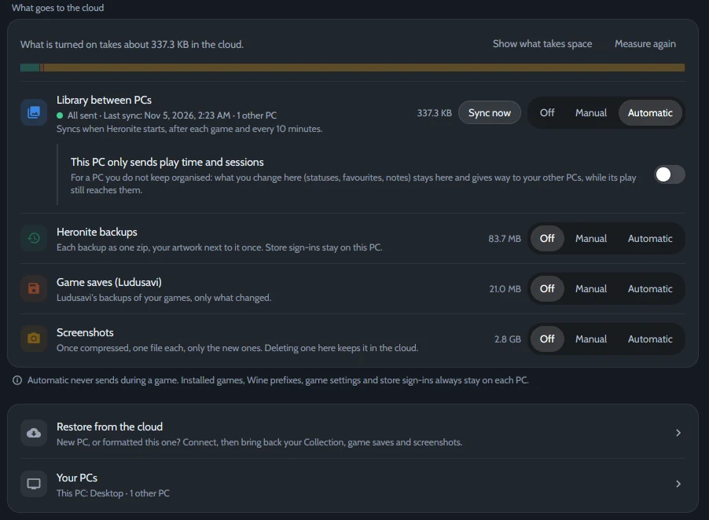

*Ajustes → Nube, sincronizada con otro PC.*

## Qué se sincroniza

| Se sincroniza | Se queda en cada PC |
|---|---|
| Estados, favoritos y valoraciones | Juegos instalados |
| Notas y juegos ocultos | Prefijos de Wine |
| Tiempo de juego y sesiones | Ajustes de los juegos e inicios de sesión de las tiendas |

Tus datos van solo a la carpeta o cuenta que elijas.

## Elige dónde se encuentran tus PC

| Servicio | Ideal para |
|---|---|
| **Una carpeta compartida** | Un dual boot, o una carpeta que Syncthing, Dropbox u OneDrive ya sincronizan |
| **Google Drive, Dropbox, OneDrive o Box** | PC en lugares distintos. Inicias sesión una vez, en el navegador |
| **FTP, SMB o WebDAV** | Un NAS o un servidor en casa |
| **Un remoto de rclone** | Cualquier otro servicio que configuraste con `rclone config` |

Las cuentas y los servidores pasan por [rclone](https://rclone.org/). Heronite lo descarga si no está instalado.

## Configúralo

1. Abre **Ajustes → Nube**.
2. En **Servicio**, elige dónde se encuentran tus PC. Para una cuenta o un servidor, pulsa **Conectar**. Para una carpeta compartida, elige la **Carpeta de sincronización**.
3. En **Elige qué va, y cuándo**, pon **Biblioteca entre PC** en **Automático**.
4. Haz lo mismo en tus otros PC, con la misma cuenta o carpeta.

**Automático** sincroniza cuando Heronite se abre, después de cada juego y cada 10 minutos. **Manual** espera a que pulses **Sincronizar ahora**.

## En un dual boot Linux y Windows

1. Elige un disco que monten los dos sistemas al iniciar, en **NTFS** o **exFAT**, y usa una carpeta en él como **Carpeta de sincronización** en ambos.
2. En Windows, desactiva el **Inicio rápido**. Si no, Linux monta el disco solo para lectura.
3. En **Tus PC**, ponle un nombre a cada lado, como *Linux* y *Windows*.

## Cuando dos PC no coinciden

Cada PC escribe solo su propio archivo, así que el servicio de sincronización nunca tiene dos copias entre las que elegir. Heronite las combina:

- **Estados, favoritos, valoraciones y notas:** gana el cambio más reciente, campo por campo.
- **Sesiones:** se guardan las de todos los PC, sin repetir.
- **Tiempo de juego:** gana el total más alto, salvo que lo hayas bajado a mano.
- **Un juego que solo está en un PC:** sus datos esperan, y llegan cuando añadas ese juego en el otro PC.

## Más opciones

- **Este PC solo envía tiempo de juego y sesiones:** para un PC que no mantienes organizado. El tiempo de juego y las sesiones cuentan en todos los PC; los estados, favoritos, valoraciones, juegos ocultos y notas vienen de los demás PC.
- **Copias de Heronite, guardados de los juegos y capturas** pueden ir a la misma cuenta. Consulta [Copias de seguridad](/es/docs/backups-and-saves/).
- **PC nuevo:** configúralo como arriba y pulsa **Restaurar todo** en **Restaurar desde la nube**. Trae la copia de Heronite, los guardados y las capturas que envió otro PC, y reinicia Heronite. Después, la sincronización lo mantiene al día.
