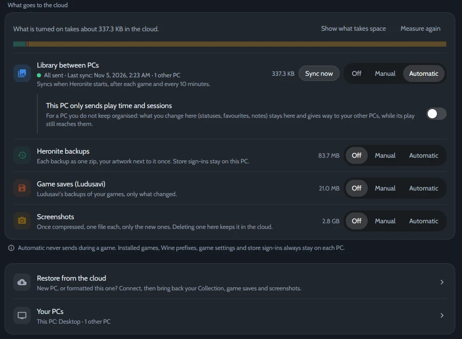

*Settings → Cloud, synchronisé avec un autre PC.*

## Données synchronisées

| Synchronisé | Reste sur chaque PC |
|---|---|
| Statuts, favoris et évaluations | Jeux installés |
| Notes et jeux masqués | Préfixes Wine |
| Temps de jeu et sessions | Réglages des jeux et connexions aux boutiques |

Vos données vont uniquement vers le dossier ou compte choisi.

## Choisir un emplacement commun aux PC

| Service | Usage conseillé |
|---|---|
| **Dossier partagé** | Double démarrage ou dossier déjà synchronisé par Syncthing, Dropbox ou OneDrive |
| **Google Drive, Dropbox, OneDrive ou Box** | PC distants, connexion une fois dans le navigateur |
| **FTP, SMB ou WebDAV** | NAS ou serveur personnel |
| **Destination rclone** | Autre service configuré avec `rclone config` |

Les comptes et serveurs passent par [rclone](https://rclone.org/), téléchargé par Heronite si absent.

## Configurer la synchronisation

1. Ouvrez **Settings → Cloud**.
2. Sous **Service**, choisissez l’emplacement. Pour un compte ou serveur, **Connect** ; pour un dossier partagé, choisissez **Sync folder**.
3. Sous **Choose what goes, and when**, réglez **Library between PCs** sur **Automatic**.
4. Répétez sur les autres PC avec le même compte ou dossier.

**Automatic** synchronise au démarrage, après chaque jeu et toutes les 10 minutes. **Manual** attend **Sync now**.

## En double démarrage Linux et Windows

1. Choisissez un lecteur **NTFS** ou **exFAT** monté au démarrage par les deux systèmes, et un même dossier **Sync folder**.
2. Désactivez le **Démarrage rapide** de Windows, sinon Linux monte le lecteur en lecture seule.
3. Sous **Your PCs**, nommez chaque système, par exemple *Linux* et *Windows*.

## Quand deux PC divergent

Chaque PC écrit son propre fichier, évitant au service de synchronisation de choisir entre deux copies. Heronite fusionne :

- **Statuts, favoris, évaluations et notes :** la modification la plus récente gagne, champ par champ.
- **Sessions :** toutes sont conservées sans doublons.
- **Temps de jeu :** le plus grand total gagne, sauf réduction manuelle.
- **Jeu présent sur un seul PC :** les données attendent son ajout sur l’autre PC.

## Autres options

- **This PC only sends play time and sessions :** pour un PC dont vous ne gérez pas l’organisation. Temps et sessions comptent partout ; statuts, favoris, évaluations, jeux masqués et notes viennent des autres PC.
- **Copies de sécurité, sauvegardes de jeu et captures** peuvent aller vers le même compte. Voir [Copies de sécurité et sauvegardes](/fr/docs/backups-and-saves/).
- **Nouveau PC :** la synchronisation complète les jeux déjà présents. Pour toute la bibliothèque, voir [Configurer un nouveau PC depuis le cloud](/fr/docs/backups-and-saves/#configurer-un-nouveau-pc-depuis-le-cloud).
