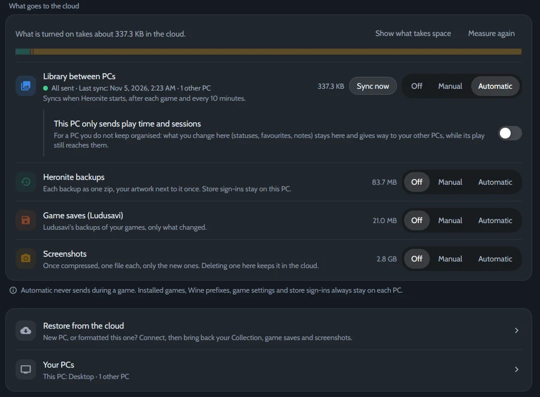

Jogue em um PC e os outros ficam sabendo: os mesmos status, notas e tempo de jogo em todos. Funciona também entre o Linux e o Windows de um mesmo PC com dual boot.

*Configurações → Nuvem, sincronizada com outro PC.*

## O que sincroniza

| Sincroniza | Fica em cada PC |
|---|---|
| Status, favoritos e notas de avaliação | Jogos instalados |
| Anotações e jogos ocultos | Prefixos Wine |
| Tempo de jogo e sessões | Configurações dos jogos e logins das lojas |

Seus dados vão só para a pasta ou conta que você escolher.

## Escolha onde seus PCs se encontram

| Serviço | Melhor para |
|---|---|
| **Uma pasta compartilhada** | Um dual boot, ou uma pasta que o Syncthing, o Dropbox ou o OneDrive já sincronizam |
| **Google Drive, Dropbox, OneDrive ou Box** | PCs em lugares diferentes. Você faz login uma vez, no navegador |
| **FTP, SMB ou WebDAV** | Um NAS ou um servidor em casa |
| **Um remote do rclone** | Qualquer outro serviço que você configurou com `rclone config` |

Contas e servidores passam pelo [rclone](https://rclone.org/). O Heronite baixa ele se não estiver instalado.

## Configure

1. Abra **Configurações → Nuvem**.
2. Em **Serviço**, escolha onde seus PCs se encontram. Para uma conta ou um servidor, clique em **Conectar**. Para uma pasta compartilhada, escolha a **Pasta de sincronização**.
3. Em **Escolha o que vai, e quando**, coloque **Biblioteca entre PCs** em **Automático**.
4. Faça o mesmo nos outros PCs, com a mesma conta ou pasta.

**Automático** sincroniza quando o Heronite abre, depois de cada jogo e a cada 10 minutos. **Manual** espera você clicar em **Sincronizar agora**.

## Em um dual boot Linux e Windows

1. Escolha um disco que os dois sistemas montam, em **NTFS** ou **exFAT**, e use uma pasta nele como **Pasta de sincronização** nos dois sistemas.
2. No Windows, desligue a **Inicialização Rápida**. Senão o Linux monta o disco só para leitura.
3. Em **Seus PCs**, dê um nome para cada lado, como *Linux* e *Windows*.

## Quando dois PCs discordam

Cada PC grava só o próprio arquivo, então o serviço de sincronização nunca fica com duas cópias para escolher. O Heronite junta os dados:

- **Status, favoritos, notas de avaliação e anotações:** vale a mudança mais recente, campo por campo.
- **Sessões:** as sessões de todos os PCs se somam.
- **Tempo de jogo:** vale o maior total, a não ser que você tenha diminuído ele à mão.
- **Um jogo que só um PC tem:** os dados dele esperam, e chegam quando você adicionar esse jogo no outro PC.

## Mais opções

- **Este PC envia só tempo de jogo e sessões:** para um PC que você não mantém organizado. O que você joga nele conta em todos, e os status e anotações dos outros PCs prevalecem.
- **Backups, saves dos jogos e capturas de tela** podem ir para a mesma conta. Veja [Backups e saves](/pt-br/docs/backups-and-saves/).
- **PC novo:** conecte na mesma conta e clique em **Restaurar tudo** em **Restaurar da nuvem**.
