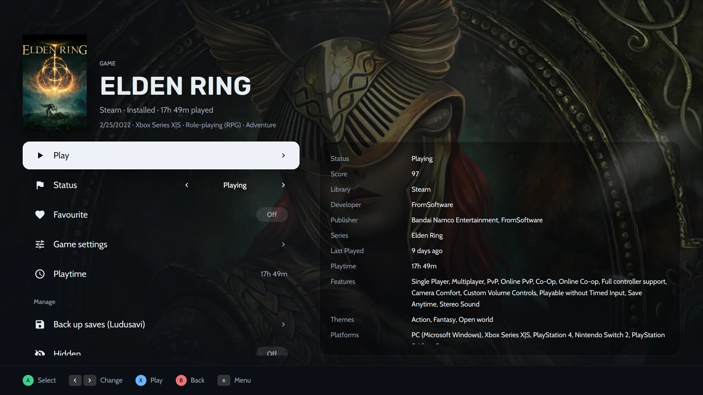

A PC game library is made for a mouse. A TV is not. Console mode turns Heronite into a **couch game launcher**: big covers, one thing in focus at a time and every action on a controller button. Your whole [Collection](/features/game-library/) is there, from every store, emulator and loose game you added, so you do not need a different launcher for the living room.

## How do I turn on console mode?

There are three ways:

- From the command palette (<kbd>Ctrl</kbd> <kbd>K</kbd>) or the ☰ menu.
- Start Heronite with `--console`, for example in a Steam shortcut or a gaming session.
- In **Settings → Console mode**, make it open at startup or when a controller connects. For each you can choose off, ask or on.

Nothing of console mode loads while it is off, so it costs you nothing on the desktop.

> **Tip.** "When a controller connects" is handy for a PC under the TV. Switch on the pad and Heronite is already in console mode when you sit down.

## Controller and keyboard buttons

Everything works with a gamepad. The on-screen hints at the bottom of each page follow your controller, with Xbox, PlayStation, Nintendo or Steam Deck button pictures, or you can set them by hand.

| Controller | Action |
|---|---|
| A (south) | Confirm |
| B (east) | Back |
| X, Y | Actions shown on screen |
| LB / RB | Switch tabs |
| D-pad, left stick | Move |
| Right stick | Scroll |
| Start or Guide | Menu |

Prefer the Nintendo layout? Swap A and B in the theme's controls.

No gamepad nearby? The keyboard acts as one:

| Key | Acts as |
|---|---|
| Arrows | Move |
| <kbd>Enter</kbd> or <kbd>Space</kbd> | A |
| <kbd>Esc</kbd> or <kbd>Backspace</kbd> | B |
| <kbd>X</kbd>, <kbd>Y</kbd> | X, Y |
| <kbd>Q</kbd> / <kbd>E</kbd> | LB / RB |
| <kbd>PgUp</kbd> / <kbd>PgDn</kbd> | Scroll |
| <kbd>M</kbd> or <kbd>F1</kbd> | Start (menu) |
| <kbd>Tab</kbd> | Select |

## Browse and play from the sofa

The first tab is usually **Home**: the game you are about to continue is shown large over its art, with shelves under it such as *Continue playing* and *Favourites*. Press A for its page, X to play at once and Y to search.

*The Library tab lists the whole Collection as covers, with filters for what to show, how to sort and which status.*

A game's page keeps the actions in one list: **Play**, **Status**, **Favourite**, **Game settings**, **Playtime** and, with [Ludusavi](/features/saves-and-backups/) installed, a **Back up saves** row. Details such as score, developer, series, last played and features sit to the right.

*A game page in console mode: play, change its status, open its settings or back up its saves, all with the controller.*

## Eight layouts, up to four tabs

You are not stuck with one design. Console mode has up to **four tabs**, and each tab has its own layout and its own games. The layouts are:

- Shelves
- Spotlight
- Cinema
- Dashboard
- Grid
- Wheel
- Carousel
- Series X

A tab can show all games, only installed ones, favourites, one status, one store, one platform and more. So you might keep a *Home* tab with shelves, an *Installed* tab as a grid and a *Retro* tab as a wheel for your emulated games. Switch between tabs with LB and RB.

Shelves can show recent games, favourites, installed games, short backlog picks and a random pick. The Dashboard layout can show your week, downloads, a pick from your backlog, your journal and shortcuts.

## Seven themes, and your own

Seven themes come built in: **Minimal**, **Classic**, **Cinema**, **Pulse**, **Arcade**, **Hub** and **Living room**. Pick one as a starting point, then change what you like, live from the couch or in **Settings → Console mode**:

- covers, tile shape and size,
- background, with the game's art, a blurred cover, screenshots or a picture of your own,
- accent colour, fonts, size of the interface and the clock,
- button pictures,
- the menu (sidebar, grid, dock or rail) and the game pages.

### Share a theme

Export your theme to a `.heronite-theme.json` file and import it on any PC. A background picture goes inside the file, so one file is all you need to share. You can post yours in [Discussions](https://github.com/RafaelGoulartB/Heronite/discussions) for others to try.

The file is plain JSON and every field is optional, so a short file works too. The [theme format](/docs/console-theme-format/) lists every field if you want to edit one by hand.

## On-screen keyboard and Power menu

With no keyboard in reach, console mode brings its own **on-screen keyboard** for typing, and a **Power menu**, so you never need to pick up the mouse. The Menu button (Start or Guide on a controller, <kbd>M</kbd> or <kbd>F1</kbd> on a keyboard) opens the main menu from any page.

## Does console mode make Heronite heavier?

No. It is built into the same native Rust app as the desktop launcher, which stays light on your PC, and nothing of console mode is loaded while it is off.

## Can I use it on the Steam Deck?

Yes. Heronite runs on Linux as an AppImage, which is how apps are usually installed in SteamOS desktop mode, and console mode is made for controllers. To use it from Gaming Mode, add the AppImage to Steam as a non-Steam game with the `--console` option. Step by step, it is in the [Steam Deck guide](/guides/steam-deck/).

## In-game overlay and Replay (beta, Linux)

With the overlay turned on, the controller's Guide button opens a panel over the game with volume, microphone, FPS limit, screenshots and journal notes.

| Buttons | Action |
|---|---|
| Guide | Open or close the panel (<kbd>Super</kbd> <kbd>G</kbd> on the keyboard) |
| Guide + RB | Screenshot |
| Guide + ↑ / ↓ | Volume |
| Guide + Y | Mark a moment |
| Guide + X | Save the replay |

**Replay** is off by default. When on, it keeps the last seconds of play, recorded on the GPU by [gpu-screen-recorder](https://git.dec05eba.com/gpu-screen-recorder/about/).

> **Note.** The overlay needs a Wayland session whose compositor supports layer-shell, such as KDE Plasma, Hyprland or Sway. It does not work on GNOME or X11.

## More in the docs

The [Console mode](/docs/console-mode/) page lists every button, setting and overlay option, and [Keyboard shortcuts](/docs/keyboard-shortcuts/) covers the desktop. Not installed yet? [Download Heronite](/download/) for Linux or Windows. It is free and open source.
