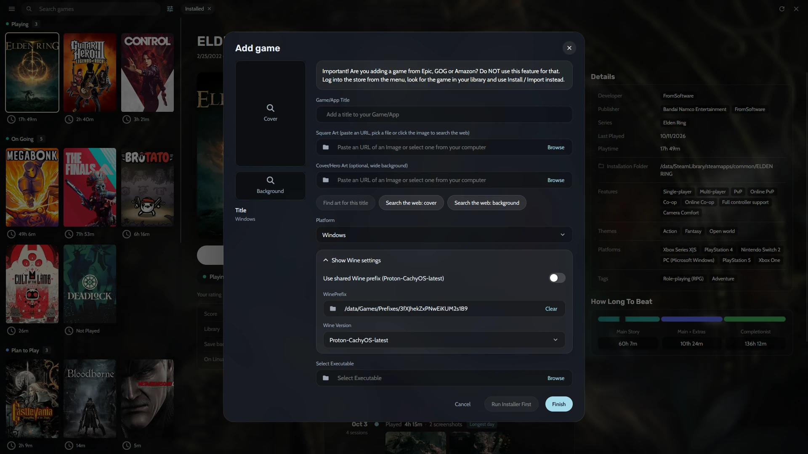
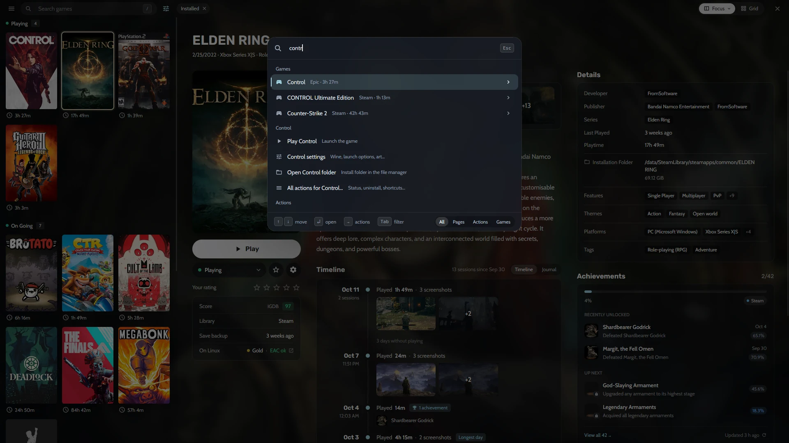

## How do I get all my games into one Collection?

- **Steam:** Heronite reads your [Steam](/features/stores/) libraries with no login.
- **Epic Games, GOG and Amazon Games:** log in on the **Stores** page and Heronite adds the whole library, installed or not.
- **Battle.net, EA app, Ubisoft Connect and Rockstar Games:** the games you install in each store app show up. On Linux, the store app runs in its own Wine prefix (a separate Windows folder for that app).
- **Microsoft Store and PC Game Pass (Windows):** Heronite adds the games the Xbox app installed, with no login.
- **Emulators:** Heronite [detects them](/features/emulation/) and scans your ROM folders.
- **Other launchers:** Heroic, Lutris, Bottles and Faugus games on Linux, and Playnite games on Windows, imported and kept in sync.

## How do I add a game that is not from a store?

Press <kbd>Ctrl</kbd> <kbd>N</kbd> (or **Add a game**) to add:

- A Windows program (`.exe`), run through [Wine or Proton](/features/wine-and-proton/) on Linux
- A native Linux program, an AppImage or a start script
- A browser game, by its web address
- A ROM, or a whole ROM folder

To add many games at once, choose **Add from folder** in the ☰ menu.

*Adding a Windows game on Linux.*

## How do I group, filter and sort my games?

**Focus** is a list with a details panel: cover, screenshots, description and a timeline of play sessions. The **grid** shows covers only.

On either layout, group games by:

- Status, such as Playing, On going, Plan to play or Finished
- Store
- Genre
- Series
- Release year or another field

Save filters and sorting as **views**, such as *Playing now*, *Backlog*, *Finished* or *Favourites*.

## How do I search the Collection?

Start typing anywhere in the Collection. Search forgives small typos, and <kbd>Enter</kbd> plays or installs the first result.

The **command palette** (<kbd>Ctrl</kbd> <kbd>K</kbd>) opens any page, runs any action and plays any game by part of its name. Press <kbd>→</kbd> on a game for its actions, like opening its settings or install folder.

*Searching "contr" in the command palette.*

## How do I edit many games at once?

1. Select games with <kbd>Space</kbd>, <kbd>Shift</kbd> + arrows or <kbd>Ctrl</kbd> <kbd>A</kbd>.
2. Press <kbd>F3</kbd>.
3. Change their status, genres, series, companies and more.

<kbd>Ctrl</kbd> <kbd>Z</kbd> undoes the change. You can rename and merge genres, companies and series, so *RPG* and *Role-playing (RPG)* become one.

## Where do covers and game details come from?

Covers, backgrounds and logos come from the stores and from Steam and Lutris metadata. So do descriptions and release dates. Two optional free keys add more:

- [SteamGridDB](https://www.steamgriddb.com) for community covers, good for emulated and DRM-free games
- [IGDB](https://www.igdb.com) for descriptions, genres and series

Each game shows **How Long To Beat** times, **ProtonDB** ratings on Linux, **anti-cheat status** from Are We Anti-Cheat Yet? and **achievements** from Steam and RetroAchievements. Add the keys in **Settings → Metadata**; [Metadata and art](/docs/metadata-and-art/) has the steps.

## Can I keep notes on a game?

Yes. Every game has a **journal** for notes, such as where you left off or what you thought of an ending. It shares a timeline with your [play sessions](/features/play-time-tracking/) and the screenshots you took.
