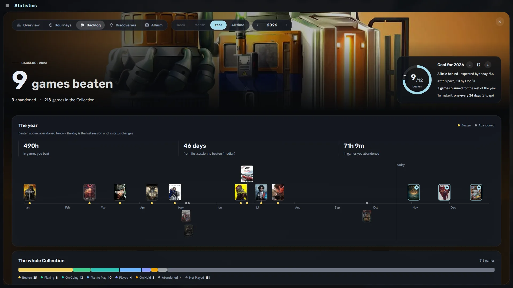
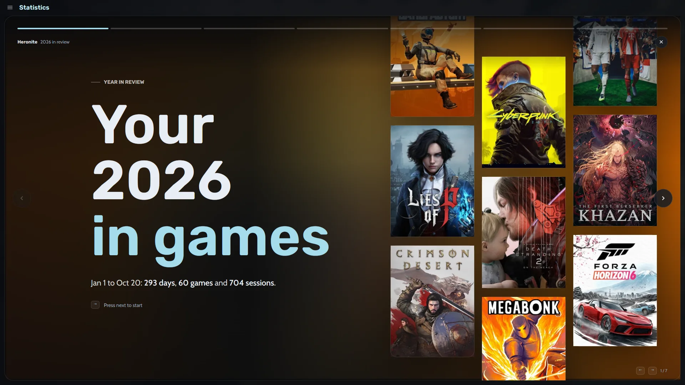
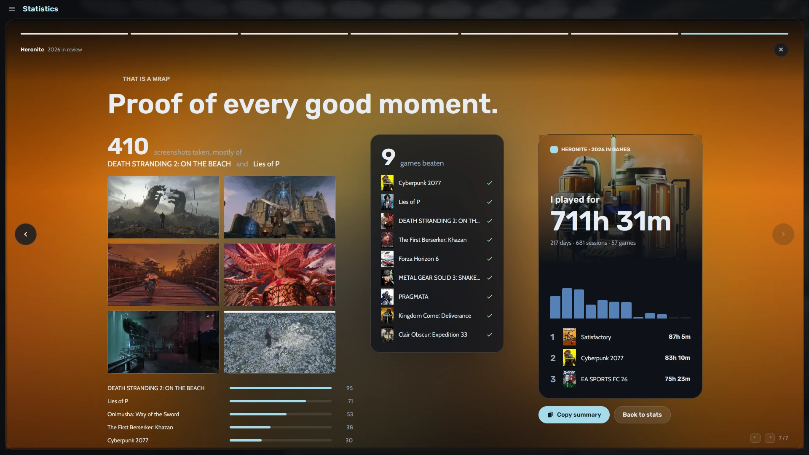

Play time shows under each cover, in a game's details, on its timeline and on its console mode page.

Heronite saves everything on your PC as plain JSON files, with no telemetry. To back it up, see [saves and backups](/features/saves-and-backups/).

## Where do I see my gaming statistics?

Open **Statistics** with <kbd>Ctrl</kbd> <kbd>6</kbd>. Choose **Week**, **Month**, **Year** or **All time** at the top, and use the arrows to change period. The **Overview** tab shows:

- Total time played, compared with the period before
- Days played, your play streak and the number of sessions
- Your busiest day and your top games
- A **day-by-day chart** where each colour is a different game

The other tabs:

- **Journeys** shows your games over time and which ones you played at the same time.
- **Backlog** follows your goal and the games you beat.
- **Discoveries** points out things like going back to an old game after months away.
- **Album** collects the screenshots you took.

## How do I set a yearly backlog goal?

1. Open **Statistics** (<kbd>Ctrl</kbd> <kbd>6</kbd>) and its **Backlog** tab.
2. Set a goal for the year with the minus and plus buttons.

A progress ring shows how many games you have beaten, whether you are on track and what pace you need. Heronite compares your hours with **[How Long To Beat](https://howlongtobeat.com)**.

*The Backlog tab with its goal ring and timeline of beaten games.*

Beneath the ring:

- A timeline of the year, with beaten games above the line and abandoned ones below
- The hours you put into games you beat and into games you abandoned
- How many days you take from first session to beaten (the median)
- Your Plan to play queue and how long it would take at your usual pace

## How do I open my gaming year in review?

Open the banner on the **Statistics** page, or press <kbd>Ctrl</kbd> <kbd>K</kbd> and type "Year in review". Heronite shows your year as **seven full-screen stories**, at year end or any time before.

*The first story, over a wall of covers.*

The stories cover your busiest month, longest streak, longest break and game of the year. The last ones show when you usually play, then a wrap-up. **Copy summary** copies a short text of your year to post anywhere.

*The last story ends with a card for your year, ready to share.*

## How do I add notes and screenshots to my play history?

Each game has a **journal** for notes, such as where you left off. It sits on the same timeline as your sessions.

For screenshots, press <kbd>F10</kbd> while playing. Heronite matches the screenshot to the game, and you can change the key in **Settings → Screenshots**. The **Album** tab and each game's page show what you captured.

Next: [download Heronite](/download/).
