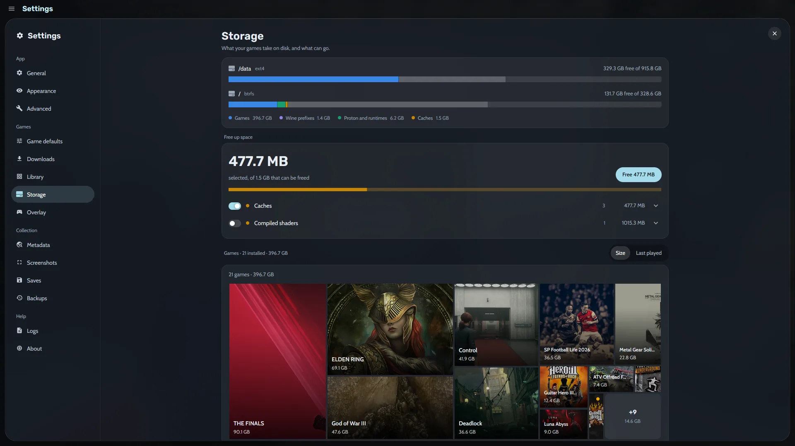
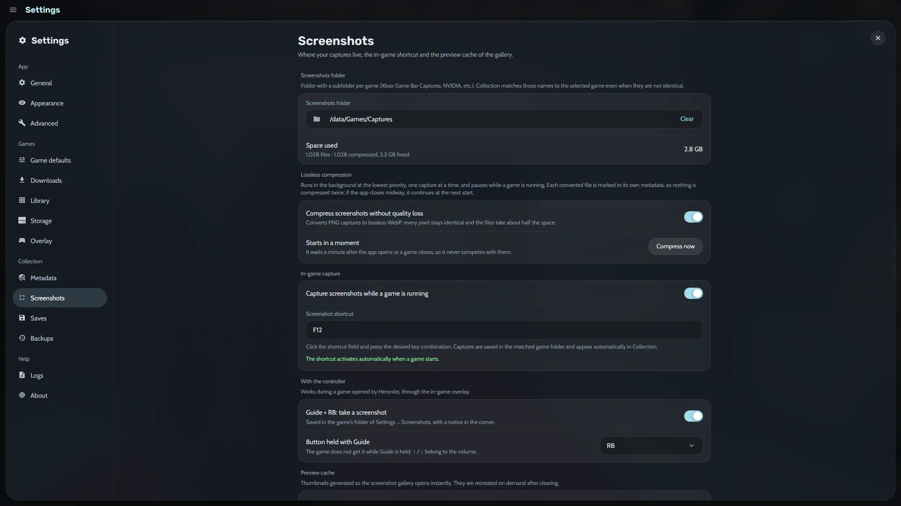

[Ludusavi](https://github.com/mtkennerly/ludusavi) is a free program that knows where thousands of games keep their saves, in a Windows folder, a Steam folder or the game's Wine prefix (a separate Windows folder for that game). Install it once, and Heronite backs up a game's saves after each session.

## How do I install Ludusavi for Heronite?

1. Install Ludusavi from [its releases](https://github.com/mtkennerly/ludusavi/releases/latest), your distribution, winget or Scoop.
2. In **Settings → Saves**, choose where backups go and how many full backups to keep per game.

On Linux, Heronite looks for Ludusavi on `PATH`, `/usr/bin`, `/usr/local/bin` and `~/.local/bin`. Ludusavi updates its list of games once a day. More in [Backups and saves](/docs/backups-and-saves/).

## How do I restore a game save?

1. Close the game.
2. Open the game's page and its **Saves** tab, which lists the game's backups.
3. Choose a backup and press **Restore…**.
4. Choose the files to put back under **Files to restore**, then confirm.

In **console mode** this is one row on the game's page, **Back up saves (Ludusavi)**.

- Heronite keeps a copy of what the restore replaced, and **Undo** puts it back.
- Name a backup, such as "Before the last boss", and **lock** it so Heronite never removes it.
- Emulated games can continue from [save states](/features/emulation/) instead.

## Does Heronite sync Epic and GOG cloud saves?

Yes, in beta, on Linux and Windows. Open the game's **Game settings → Cloud saves** and press **Sync**, or turn on **Sync automatically** to sync when the game starts and after it exits. Back up your saves before the first sync.

## How do I schedule backups of my whole Collection?

1. Open **Settings → Backups**.
2. Choose a backup folder.
3. Choose a schedule: **daily**, **weekly**, **monthly** or only when you press **Back up now**.

A backup protects your statuses, ratings, journal and [play history](/features/play-time-tracking/). Heronite keeps the newest 10 backups by default.

Each backup is a dated folder you can browse. Heronite shares unchanged files with the previous backup, so a new one takes only the space of what changed. Scheduled backups run while Heronite is open and never during a game.

### What goes inside a backup?

| Part | What is in it |
|---|---|
| Collection (always) | Your games, sessions, statuses, journal and per-game settings |
| Settings | Appearance, console mode themes and the other settings |
| Art | Covers and art you chose |
| Logins | Your store logins |

Installed games, Wine and Proton builds, caches and logs stay out, because you can download them again.

### How do I restore a Collection backup?

1. In **Settings → Backups**, choose a backup to see what it holds.
2. Choose the parts to put back.
3. Press **Restore…**, then **Restore and restart**.

Heronite backs up what you have now first, so you can go back. See [Files and folders](/docs/files-and-folders/).

## Can I keep the same library on several PCs?

Yes. **Settings → Cloud** keeps statuses, favourites, notes, play time and sessions the same on every PC, such as a dual boot's Linux and Windows. It syncs through a shared folder, or a cloud account such as Google Drive, Dropbox or OneDrive.

The same place can hold your Heronite backups, Ludusavi save backups and screenshots. Set it up in [Backups and saves](/docs/backups-and-saves/#sync-your-library-between-pcs).

## Where did my disk space go?

**Settings → Storage** shows what your games take on each disk, with bars for games, Wine prefixes, Proton and runtimes, and caches. A **treemap** draws every installed game as a block sized by its disk space. Sort it by size or by when you last played.

*Storage settings, with a Free up space card.*

**Free up space** lists what can go, such as caches and compiled shaders. On Linux it finds unused Wine prefixes, unused Proton builds and Steam leftovers for games no longer installed. Heronite moves prefixes and leftover folders to the trash and refuses to remove folders that another game still uses.

## How do I manage screenshots and the space they take?

Screenshots live in a folder you choose in **Settings → Screenshots**, which shows the space they use. A switch compresses PNG captures to lossless WebP, which keeps every pixel and takes about half the space. Compression pauses while a game runs.

*Screenshots settings.*

Press <kbd>F10</kbd> while you play to capture a screenshot, and change the key in the same settings. With a controller, the [in-game overlay](/features/console-mode/) takes one with Guide + RB. Heronite matches captures to the game, so they appear in your [statistics](/features/play-time-tracking/) and journal.

Next: [download Heronite](/download/).
