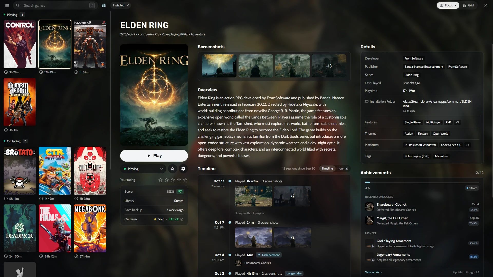

## Which stores does Heronite support?

| Store or launcher | Linux | Windows | How it works |
|---|---|---|---|
| Steam | Yes | Yes | No login; Heronite reads your libraries |
| Epic Games | Yes | Yes | Log in; Heronite installs the games |
| GOG | Yes | Yes | Log in; Heronite installs the games |
| Amazon Games | Yes | Yes | Log in; Heronite installs the games |
| Battle.net | Yes | Yes | Log in; the store app installs the games |
| EA app | Yes | Yes | Log in; the store app installs the games |
| Ubisoft Connect | Yes | Yes | Log in; the store app installs the games |
| Rockstar Games | Yes | Yes | Log in; the store app installs the games |
| Microsoft Store and PC Game Pass | No | Yes | No login; Heronite reads the Xbox app's games |

Your [emulated games](/features/emulation/) share the same [library](/features/game-library/). To add a game that is not from a store, see [Add other games to your library](/docs/getting-started/#add-other-games-to-your-library).

## How do I log in to Epic, GOG and Amazon?

1. Open **Stores** (<kbd>Ctrl</kbd> <kbd>4</kbd>).
2. Choose **Epic Games**, **GOG** or **Amazon Games**.
3. Press **Log in**.
4. Log in on the store's page in the window that opens.

If the login window does not open, use **Or log in with your browser** on the same page and paste the code it gives you. Step by step: [Epic Games](/guides/epic-games-on-linux/), [GOG](/guides/gog-on-linux/) and [Amazon Games](/guides/amazon-games-on-linux/).

On Windows, Heronite also adds games already installed by the Epic Games Launcher, GOG Galaxy or the Amazon Games app. Nothing downloads again.

Heronite downloads the open source tools Heroic uses: [legendary](https://github.com/derrod/legendary) for Epic, [gogdl](https://github.com/Heroic-Games-Launcher/heroic-gogdl) for GOG and [nile](https://github.com/imLinguin/nile) for Amazon.

## How does Heronite download and update games?

Press **Install** on a game. One download queue installs, updates, repairs and uninstalls your Epic, GOG and Amazon games. The same queue moves and imports games. Heronite pauses downloads offline, retries failed ones and checks for updates every 3 hours.

## Do I need to log in to Steam?

No. Heronite reads your Steam libraries and keeps them in sync. On Linux, it finds the regular Steam install, the Flatpak and the Snap. On Windows, it reads Steam's location from the registry, and you can [run a trainer with a Steam game](/docs/stores-and-launchers/#run-a-trainer-with-a-steam-game-windows).

*A Steam game's page, next to games from other stores.*

## Can I run Battle.net, EA, Ubisoft and Rockstar games?

Yes, on Linux and Windows. You log in and install games in the store app. Heronite lists those games, starts them through the store app and counts their play time.

On Linux, Heronite installs each store app in its own Wine prefix (a separate Windows folder for that app) under `~/Games/Heronite/Prefixes/<store>`. It runs the app through [Wine and Proton](/features/wine-and-proton/). Step by step: [Battle.net](/guides/battle-net-on-linux/) and [EA app, Ubisoft Connect and Rockstar](/guides/ea-app-ubisoft-rockstar-on-linux/).

On Windows, the store app runs directly, without Wine. Press the app's **Set up** button, such as **Set up Battle.net**, to download and run the official installer.

## How do I add Microsoft Store and PC Game Pass games?

On Windows, Heronite finds games installed by the Xbox app or Microsoft Store, including PC Game Pass. No login needed. The Xbox app still installs, updates and uninstalls them.

**Stores → Xbox** shows whether Heronite found the Xbox app, and lists its games. After you install a game, press **Read games now**.

## Can I import games from Heroic, Lutris, Bottles, Faugus or Playnite?

Yes. Turn on a launcher in **Settings → Other launchers**. Heronite never changes another launcher's files. On first start it copies Heroic's logins, settings and games added by hand once.

| Launcher | What Heronite imports |
|---|---|
| Heroic (Linux) | Games you added by hand, and your installed Epic, GOG and Amazon games |
| Lutris (Linux) | Games in its library |
| Bottles (Linux) | The programs in each bottle |
| Faugus (Linux) | Games in its list |
| Playnite (Windows) | Installed games that are not hidden, with covers and play time |

Each Linux launcher can be the normal install or the Flatpak. Playnite games still launch through Playnite. Heronite skips the launchers' Steam games, because the Steam import already has them. To switch, see the [Heroic](/compare/heroic/), [Lutris](/compare/lutris/) and [Playnite](/compare/playnite/) comparisons.

Next: [download Heronite](/download/) and add your first store.
