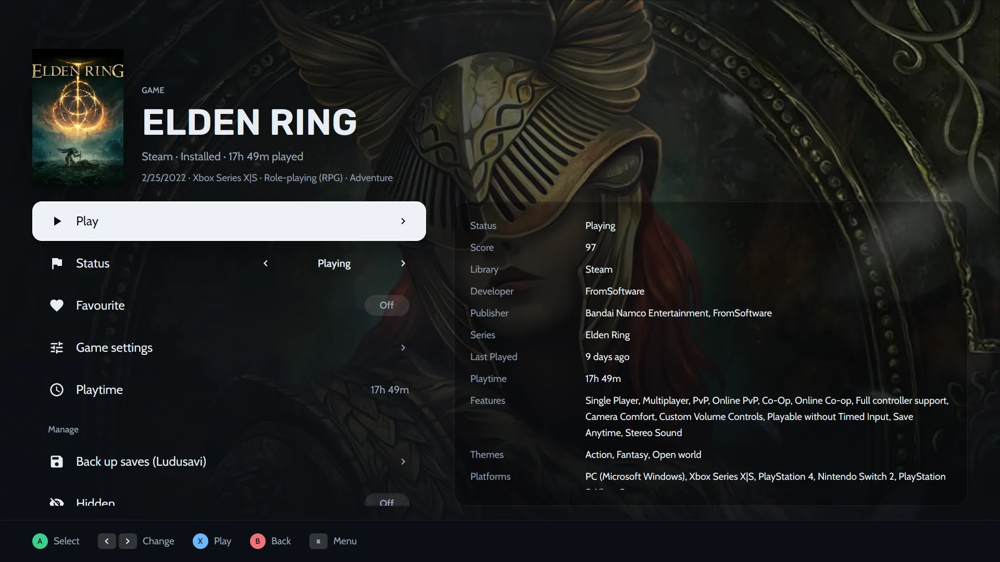

## ¿Cómo activo el modo consola?

Hay tres maneras:

- Desde la paleta de comandos (<kbd>Ctrl</kbd> <kbd>K</kbd>) o el menú ☰.
- Con la opción `--console`, por ejemplo en un acceso directo de Steam o en una sesión de juego.
- En **Ajustes → Modo consola**, donde eliges desactivado, preguntar o activado para abrirlo al arrancar o al conectar un mando.

## ¿Qué hacen los botones del mando?

Las indicaciones en la parte inferior de cada página siguen a tu mando, con imágenes de los botones de Xbox, PlayStation, Nintendo o Steam Deck.

| Mando | Acción |
|---|---|
| A (sur) | Confirmar |
| B (este) | Volver |
| X, Y | Acciones que se muestran en pantalla |
| LB / RB | Cambiar de pestaña |
| Cruceta, stick izquierdo | Moverse |
| Stick derecho | Desplazarse |
| Start o Guide | Menú |

Para el diseño de Nintendo, intercambia A y B en los controles del tema. Sin mando, el teclado hace de mando:

| Tecla | Hace de |
|---|---|
| Flechas | Moverse |
| <kbd>Enter</kbd> o <kbd>Espacio</kbd> | A |
| <kbd>Esc</kbd> o <kbd>Retroceso</kbd> | B |
| <kbd>X</kbd>, <kbd>Y</kbd> | X, Y |
| <kbd>Q</kbd> / <kbd>E</kbd> | LB / RB |
| <kbd>RePág</kbd> / <kbd>AvPág</kbd> | Desplazarse |
| <kbd>M</kbd> o <kbd>F1</kbd> | Start (menú) |
| <kbd>Tab</kbd> | Select |

## ¿Cómo exploro y juego desde el sofá?

La primera pestaña suele ser **Inicio**. Muestra el juego que vas a continuar sobre su arte, con estantes como *Seguir jugando* y *Favoritos*. Pulsa A para ver su página, X para jugar e Y para buscar.

*La pestaña Biblioteca lista toda tu [Colección](/es/features/game-library/) como carátulas.*

La página de un juego tiene estas filas:

- **Jugar**, **Estado**, **Favorito**, **Ajustes del juego** y **Tiempo de juego**
- **Copia de guardados (Ludusavi)**, con [Ludusavi](/es/features/saves-and-backups/) instalado

Los detalles, como la puntuación, el desarrollador y la última vez jugado, están a la derecha.

*La página de un juego en modo consola, con un panel de detalles a la derecha.*

## ¿Qué diseños y pestañas tiene el modo consola?

El modo consola tiene hasta **cuatro pestañas**, y cada una tiene su propio diseño y sus propios juegos. Los diseños son:

- Estanterías
- Destacados
- Cine
- Panel
- Cuadrícula
- Lista
- Carrusel
- Series X

Una pestaña puede mostrar todos los juegos, solo los instalados o solo los favoritos. También puede filtrar por un estado, una tienda o una plataforma.

## ¿Cómo cambio el aspecto del modo consola?

Elige uno de siete temas (**Mínima**, **Clásico**, **Cine**, **Pulse**, **Arcade**, **Central**, **Salón**) y cámbialo en vivo o en **Ajustes → Modo consola**:

- carátulas, forma y tamaño de los mosaicos,
- fondo, con el arte del juego, una carátula desenfocada, capturas o una imagen tuya,
- color de acento, fuentes, tamaño de la interfaz y del reloj,
- imágenes de los botones,
- el menú (barra lateral, cuadrícula, dock o riel) y las páginas de los juegos.

### ¿Cómo comparto un tema?

Exporta tu tema a un archivo `.heronite-theme.json` e impórtalo en cualquier PC. La imagen de fondo va dentro del archivo. Publica el tuyo en [Discussions](https://github.com/RafaelGoulartB/Heronite/discussions). El [formato de los temas](/es/docs/console-theme-format/) lista todos los campos, y todos son opcionales.

## ¿Puedo escribir sin teclado?

Sí. El modo consola tiene un **teclado en pantalla** y un **menú de energía**. El botón Menú abre el menú principal desde cualquier página.

## ¿Cómo inicio el modo consola desde el Modo Juego de la Steam Deck?

Instala el AppImage en el modo escritorio de SteamOS y añádelo a Steam como juego que no es de Steam con la opción `--console`. La [guía de la Steam Deck](/es/guides/steam-deck/) tiene los pasos.

## ¿Cómo uso el overlay dentro del juego y Replay (beta, Linux)?

Con el overlay activado, el botón Guide abre un panel sobre el juego. Ajusta el volumen, el micrófono y el límite de FPS, y hace capturas de pantalla y notas del diario.

| Botones | Acción |
|---|---|
| Guide | Abrir o cerrar el panel (<kbd>Super</kbd> <kbd>G</kbd> en el teclado) |
| Guide + RB | Captura de pantalla |
| Guide + ↑ / ↓ | Volumen |
| Guide + Y | Marcar un momento |
| Guide + X | Guardar el replay |

**Replay** está desactivado por defecto. Cuando se activa, conserva los últimos segundos de juego, grabados en la GPU por [gpu-screen-recorder](https://git.dec05eba.com/gpu-screen-recorder/about/).

> **Nota.** El overlay necesita una sesión de Wayland cuyo compositor admita layer-shell, como KDE Plasma, Hyprland o Sway. No funciona en GNOME ni en X11.

Siguiente: [documentación del modo consola](/es/docs/console-mode/).
