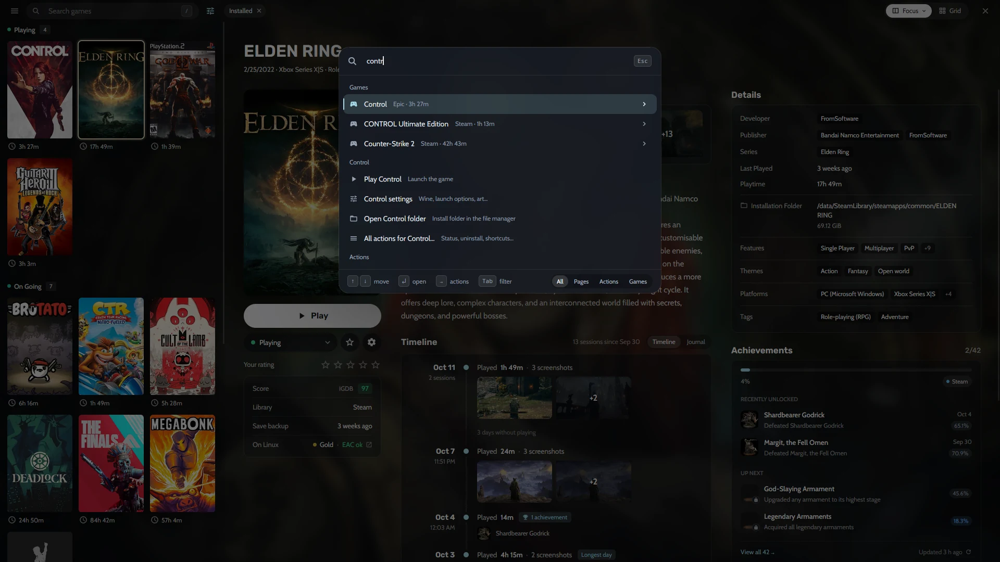

La mayoría de los jugadores de PC acaban con los juegos repartidos entre media docena de launchers: Steam para casi todo, Epic para los juegos gratis de la semana, GOG para los clásicos sin DRM, Amazon para Prime Gaming, además de una carpeta de juegos emulados y algunos instaladores sueltos. Heronite los reúne en un solo lugar, la **Colección**, y te deja organizarla como piensas tus juegos, no como los organiza cada tienda.

## Una Colección para todas las tiendas

Heronite lee tus bibliotecas de [Steam](/es/features/stores/) por sí solo, sin iniciar sesión. Inicia sesión en Epic Games, GOG o Amazon Games en la página de **Tiendas** y también entran sus bibliotecas completas, estén instaladas o no. En Linux, los clientes de Battle.net, EA app, Ubisoft Connect y Rockstar Games se ejecutan cada uno en su propio prefijo de Wine, y los juegos que instalas en ellos aparecen en la misma lista.

Los juegos emulados se suman al mismo estante. Heronite [detecta tus emuladores](/es/features/emulation/) y escanea tus carpetas de ROMs, así que un clásico de PlayStation 2 queda junto al último estreno de Steam, con su propia carátula y su tiempo de juego.

Y si ya usas otro launcher en Linux, puedes traer sus juegos: Heronite importa y mantiene sincronizados los juegos de Heroic, Lutris, Bottles y Faugus, y nunca escribe en sus archivos.

## Añade cualquier juego, de donde sea

No todos los juegos vienen de una tienda. Pulsa <kbd>Ctrl</kbd> <kbd>N</kbd> (o **Añadir un juego**) para añadir:

- un programa de Windows (`.exe`), que en Linux se ejecuta con [Wine o Proton](/es/features/wine-and-proton/),
- un programa nativo de Linux, un AppImage o un script de inicio,
- un juego de navegador, a partir de su dirección web,
- una ROM, o una carpeta entera de ROMs.

También puedes indicar a Heronite una carpeta y añadir de una vez todos los juegos que haya en ella, algo muy útil con un disco lleno de instalaciones sin DRM.

*Añadir un juego de Windows en Linux: arte, plataforma, prefijo de Wine y versión de Proton en un solo diálogo.*

## Organiza tu biblioteca de juegos a tu manera

La Colección tiene dos diseños. **Foco** es una lista con un panel de detalles grande: carátula, capturas, descripción, tiempos de How Long To Beat, logros y una línea de tiempo con cada vez que jugaste. La **cuadrícula** muestra solo carátulas, para cuando solo quieres explorar.

En cualquiera de los dos puedes **agrupar** los juegos por:

- estado (Jugando, En curso, Pendiente, Finalizado y más),
- tienda,
- género,
- serie,
- año de lanzamiento y otros campos.

Los filtros y el orden se pueden guardar como **vistas**, como *Jugando ahora*, *Backlog*, *Terminados* o *Favoritos*, para tener siempre a un clic la lista que quieres.

## Búsqueda que perdona los errores de escritura

Empieza a escribir en cualquier punto de la Colección y comienza una búsqueda. Perdona pequeños errores, así que un desliz con el dedo sigue encontrando el juego. Pulsa <kbd>Enter</kbd> para jugar o instalar el primer resultado.

Para todo lo demás está la **paleta de comandos**. <kbd>Ctrl</kbd> <kbd>K</kbd> abre cualquier página, ejecuta cualquier acción y lanza cualquier juego con solo escribir parte de su nombre. Pulsa <kbd>→</kbd> sobre un juego para ver sus acciones, como abrir sus ajustes o su carpeta de instalación.

*La paleta de comandos encuentra juegos, páginas y acciones desde el teclado.*

## Edita muchos juegos a la vez

Los datos de las tiendas no siempre son correctos, y en una biblioteca grande corregirlos uno por uno es un fastidio. Selecciona varios juegos con <kbd>Espacio</kbd>, <kbd>Shift</kbd> + flechas o <kbd>Ctrl</kbd> <kbd>A</kbd> y pulsa <kbd>F3</kbd> para cambiar de una vez su estado, géneros, series, compañías y más. <kbd>Ctrl</kbd> <kbd>Z</kbd> lo deshace.

Los géneros, las compañías y las series también se pueden renombrar y fusionar en toda la Colección, de modo que *RPG*, *Role-playing* y *Role-playing (RPG)* pasen a ser uno solo.

## Arte y detalles rellenados por ti

Las carátulas, fondos, logos, descripciones y fechas de lanzamiento se rellenan solos a partir de las tiendas y de los metadatos de Steam y Lutris. Dos claves gratuitas y opcionales lo mejoran aún más: [SteamGridDB](https://www.steamgriddb.com) para carátulas de la comunidad (ideal para juegos emulados y sin DRM) e [IGDB](https://www.igdb.com) para descripciones, géneros y series. Cada juego también muestra:

- los tiempos de **How Long To Beat**,
- las valoraciones de **ProtonDB** en Linux, para saber qué tan bien funciona un juego de Windows,
- el **estado del anti-cheat** según Are We Anti-Cheat Yet?,
- los **logros** de Steam y RetroAchievements.

Lee [Metadatos y arte](/es/docs/metadata-and-art/) para configurar las claves.

## Un diario para tus días de juego

Cada juego tiene un **diario**: notas sobre tus días de juego junto a las capturas que hiciste. Apunta dónde lo dejaste, la estrategia contra un jefe o qué te pareció un final. Está en la misma línea de tiempo que tus [sesiones de juego](/es/features/play-time-tracking/), así que un año después puedes ver qué jugaste, cuándo y qué pensaste.
