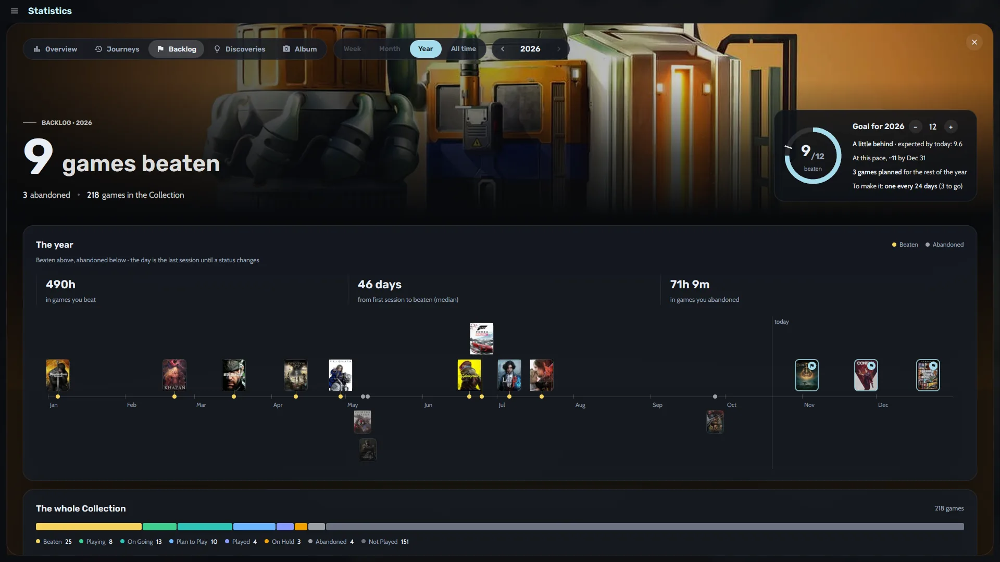
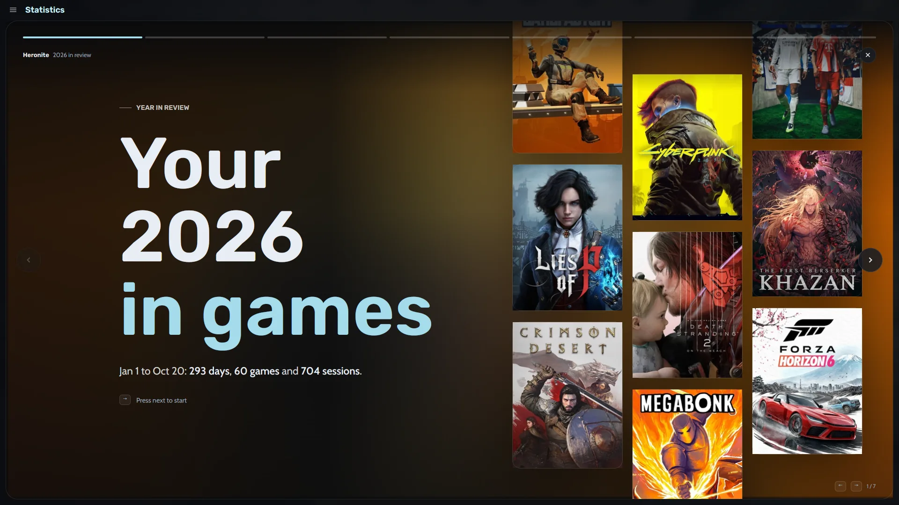
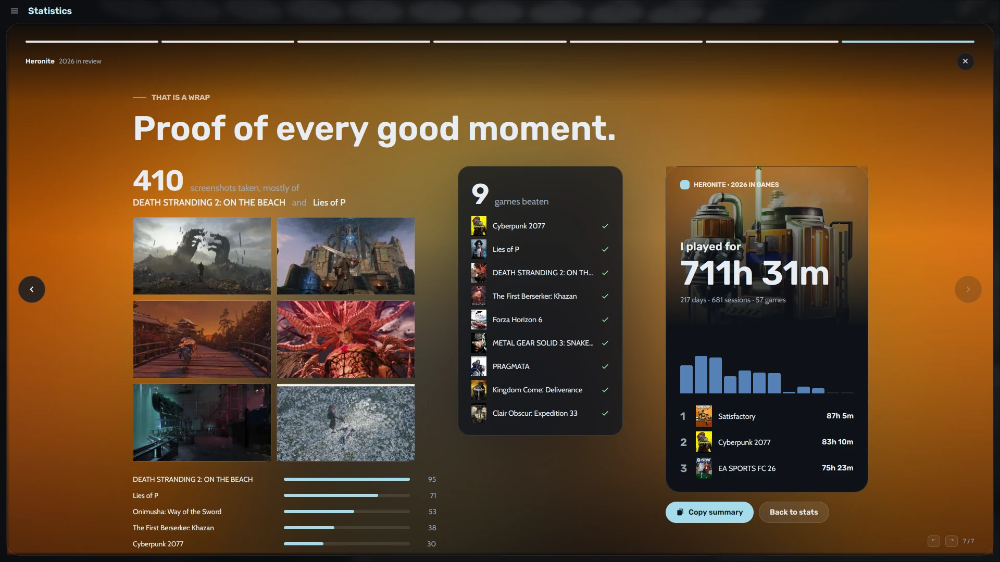

El tiempo de juego aparece bajo cada carátula, en los detalles del juego, en su línea de tiempo y en su página del modo consola.

Heronite guarda todo en tu PC como archivos JSON planos, sin telemetría. Para hacer una copia, mira [partidas guardadas y copias de seguridad](/es/features/saves-and-backups/).

## ¿Dónde veo mis estadísticas de juego?

Abre **Estadísticas** con <kbd>Ctrl</kbd> <kbd>6</kbd>. Elige **Semana**, **Mes**, **Año** o **Todo el tiempo** arriba y usa las flechas para cambiar de periodo. La pestaña **Resumen** muestra:

- El tiempo total jugado, comparado con el periodo anterior
- Los días jugados, tu racha de juego y el número de sesiones
- Tu día más activo y tus juegos más jugados
- Un **gráfico día a día** donde cada color es un juego distinto

Las otras pestañas:

- **Travesías** muestra tus juegos a lo largo del tiempo y cuáles jugaste a la vez.
- **Backlog** sigue tu meta y los juegos que terminaste.
- **Descubrimientos** destaca cosas como volver a un juego antiguo después de meses.
- **Álbum** reúne las capturas que hiciste.

## ¿Cómo fijo una meta anual de backlog?

1. Abre **Estadísticas** (<kbd>Ctrl</kbd> <kbd>6</kbd>) y su pestaña **Backlog**.
2. Fija una meta para el año con los botones de menos y más.

Un anillo de progreso muestra cuántos juegos terminaste, si vas bien y qué ritmo necesitas. Heronite compara tus horas con las de **[How Long To Beat](https://howlongtobeat.com)**.

*La pestaña Backlog, con su anillo de meta y la línea de tiempo de juegos terminados.*

Debajo del anillo:

- Una línea de tiempo del año, con los juegos terminados sobre la línea y los abandonados debajo
- Las horas que dedicaste a los juegos que terminaste y a los que abandonaste
- Cuántos días tardas desde la primera sesión hasta terminar un juego (la mediana)
- Tu cola de Pendientes y cuánto tardarías a tu ritmo habitual

## ¿Cómo abro el resumen de mi año de juegos?

Abre el banner de la página de **Estadísticas**, o pulsa <kbd>Ctrl</kbd> <kbd>K</kbd> y escribe "Resumen del año". Heronite muestra tu año en **siete historias a pantalla completa**, al final del año o en cualquier momento antes.

*La primera historia, sobre un muro de carátulas.*

Las historias cubren tu mes más activo, tu racha más larga, tu pausa más larga y el juego del año. Las últimas muestran cuándo sueles jugar y luego un cierre. **Copiar resumen** copia un texto corto de tu año para publicarlo donde quieras.

*La última historia acaba con una tarjeta de tu año, lista para compartir.*

## ¿Cómo añado notas y capturas a mi historial de juego?

Cada juego tiene un **diario** para notas, como dónde lo dejaste. Aparece en la misma línea de tiempo que tus sesiones.

Para las capturas, pulsa <kbd>F10</kbd> mientras juegas. Heronite asocia la captura al juego, y puedes cambiar la tecla en **Ajustes → Capturas**. La pestaña **Álbum** y la página de cada juego muestran lo que capturaste.

Siguiente: [descarga Heronite](/es/download/).
