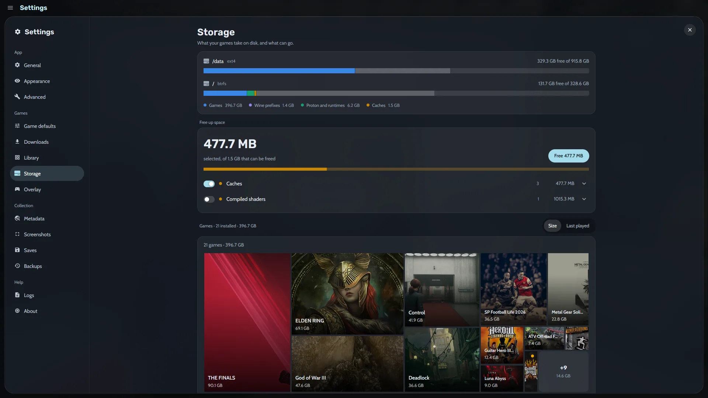
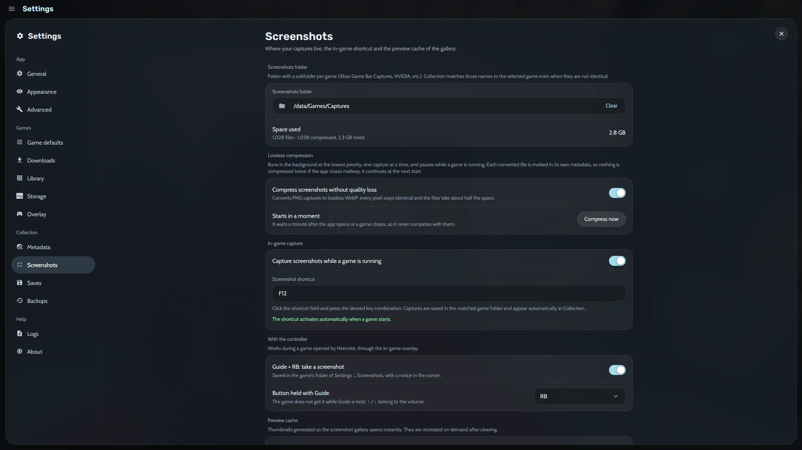

[Ludusavi](https://github.com/mtkennerly/ludusavi) es un programa gratuito que sabe dónde guardan sus partidas miles de juegos, ya sea en una carpeta de Windows, en una carpeta de Steam o en un prefijo de Wine. Instálalo una vez y Heronite hace copia de las partidas guardadas de un juego después de cada sesión.

## ¿Cómo instalo Ludusavi para Heronite?

Consigue Ludusavi en [sus releases](https://github.com/mtkennerly/ludusavi/releases/latest), en tu distribución, con winget o con Scoop. En Linux, Heronite lo busca en el `PATH`, en `/usr/bin`, `/usr/local/bin` y `~/.local/bin`.

**Ajustes → Guardados** define dónde van las copias y cuántas copias completas conserva Heronite por juego. Ludusavi actualiza su lista de juegos una vez al día. Más en [Copias y guardados](/es/docs/backups-and-saves/).

## ¿Cómo restauro una partida guardada?

1. Cierra el juego.
2. Abre la página del juego y su pestaña **Guardados**, que lista las copias de ese juego.
3. Elige una copia, selecciona los archivos que quieres devolver y restaura.

En el **modo consola** es una fila de la página del juego, **Copia de guardados (Ludusavi)**.

- Heronite conserva una copia de lo que reemplazó la restauración, y **Deshacer** la devuelve.
- Ponle nombre a una copia, como "Antes del último jefe", y **bloquéala** para que Heronite nunca la elimine.

Los juegos emulados pueden continuar desde [estados guardados](/es/features/emulation/).

## ¿Cómo programo copias de toda mi Colección?

Abre **Ajustes → Copias** para proteger tus estados, valoraciones, diario e [historial de juego](/es/features/play-time-tracking/). Elige una carpeta y una programación: **una vez al día**, **una vez a la semana**, **una vez al mes** o solo cuando pulses **Copiar ahora**. Heronite conserva por defecto las 10 copias más recientes.

Cada copia es una carpeta con fecha que puedes explorar. Heronite comparte los archivos que no cambiaron con la copia anterior, así que una nueva solo ocupa el espacio de lo que cambió. Las copias programadas se ejecutan mientras Heronite está abierto y nunca durante un juego.

### ¿Qué contiene una copia?

| Parte | Qué incluye |
|---|---|
| Colección (siempre) | Tus juegos, sesiones, estados, diario y ajustes de cada juego |
| Ajustes | Apariencia, temas del modo consola y los demás ajustes |
| Arte | Las carátulas y el arte que elegiste |
| Inicios de sesión | Tus inicios de sesión en las tiendas |

Los juegos instalados, las versiones de Wine y Proton, las cachés y los logs se dejan fuera, porque se pueden volver a descargar.

### ¿Cómo restauro una copia de la Colección?

En **Ajustes → Copias**, elige una copia para ver qué contiene y devuelve todo o una parte. Heronite primero hace copia de lo que tienes ahora, para que puedas volver atrás. Heronite aplica la restauración cuando se reinicia. Mira [Archivos y carpetas](/es/docs/files-and-folders/).

## ¿A dónde se fue el espacio de mi disco?

La página de **Almacenamiento** en Ajustes muestra lo que ocupan tus juegos en cada disco, con barras para los juegos, los prefijos de Wine, Proton y los runtimes, y las cachés. Un **treemap** dibuja cada juego instalado como un bloque cuyo tamaño depende de su espacio en disco. Ordénalo por tamaño o por la última vez que jugaste.

*Ajustes de Almacenamiento, con una tarjeta Liberar espacio.*

**Liberar espacio** lista lo que se puede quitar, como cachés y shaders compilados. En Linux encuentra prefijos de Wine sin usar, versiones de Proton sin usar y restos de Steam de juegos que ya no están instalados. Heronite manda los prefijos y las carpetas sobrantes a la papelera y se niega a eliminar carpetas que otro juego sigue usando.

## ¿Cómo gestiono las capturas de pantalla y el espacio que ocupan?

Las capturas viven en una carpeta que eliges en **Ajustes → Capturas de pantalla**, que muestra el espacio que usan. Un interruptor comprime las capturas PNG a WebP sin pérdidas, lo que conserva cada píxel y ocupa más o menos la mitad. La compresión se pausa mientras hay un juego en marcha.

*Ajustes de Capturas de pantalla.*

Pulsa <kbd>F10</kbd> mientras juegas para hacer una captura, y cambia la tecla en los mismos ajustes. Con el mando, el [overlay dentro del juego](/es/features/console-mode/) hace una con Guide + RB. Heronite asocia las capturas al juego, así que aparecen en tus [estadísticas](/es/features/play-time-tracking/) y en el diario.

Siguiente: [descarga Heronite](/es/download/).
