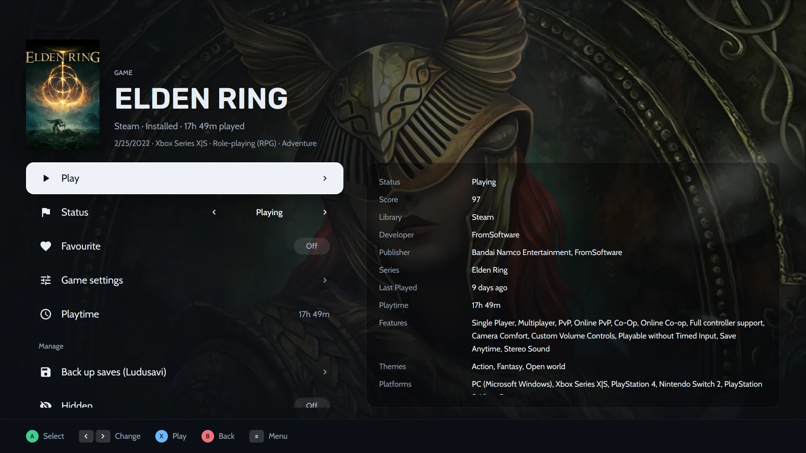

## Comment activer le mode console ?

- Ouvrez-le depuis la palette de commandes (<kbd>Ctrl</kbd> <kbd>K</kbd>) ou le menu ☰.
- Lancez Heronite avec l’option `--console`, par exemple dans un raccourci Steam ou une session de jeu.
- Dans **Settings → Console mode**, choisissez off, ask ou on pour l’ouverture au démarrage ou à la connexion d’une manette.

## À quoi servent les boutons de la manette ?

Les indications en bas de page correspondent à votre manette, avec les boutons Xbox, PlayStation, Nintendo ou Steam Deck. Pour la disposition Nintendo, inversez A et B dans les commandes du thème.

| Bouton | Action |
|---|---|
| A (sud) | Confirmer |
| B (est) | Revenir |
| X, Y | Actions affichées à l’écran |
| LB / RB | Changer d’onglet |
| Croix, stick gauche | Se déplacer |
| Stick droit | Faire défiler |
| Start ou Guide | Menu |

Sans manette, le clavier la remplace :

| Touche | Équivalent |
|---|---|
| Flèches | Se déplacer |
| <kbd>Entrée</kbd> ou <kbd>Espace</kbd> | A |
| <kbd>Échap</kbd> ou <kbd>Retour arrière</kbd> | B |
| <kbd>X</kbd>, <kbd>Y</kbd> | X, Y |
| <kbd>Q</kbd> / <kbd>E</kbd> | LB / RB |
| <kbd>Page préc.</kbd> / <kbd>Page suiv.</kbd> | Faire défiler |
| <kbd>M</kbd> ou <kbd>F1</kbd> | Start (menu) |
| <kbd>Tab</kbd> | Select |

## Comment parcourir et lancer les jeux depuis le canapé ?

Le premier onglet est généralement **Home**. Il présente le jeu à reprendre sur son illustration, avec des rangées comme *Continue playing* et *Favourites*. Appuyez sur A pour sa page, X pour jouer et Y pour rechercher.

*L’onglet Library affiche toute votre [Collection](/fr/features/game-library/) sous forme de jaquettes.*

La page d’un jeu comporte ces lignes :

- **Play**, **Status**, **Favourite**, **Game settings** et **Playtime**
- **Back up saves**, si [Ludusavi](/fr/features/saves-and-backups/) est installé

Les détails comme la note, le développeur et la dernière session sont à droite.

*La page d’ELDEN RING en mode console.*

## Quelles dispositions et quels onglets propose le mode console ?

Le mode console comporte jusqu’à **quatre onglets**, chacun avec sa disposition et ses jeux :

- Shelves
- Spotlight
- Cinema
- Dashboard
- Grid
- Wheel
- Carousel
- Series X

Un onglet affiche tous les jeux, les jeux installés ou les favoris, ou filtre par statut, boutique ou plateforme.

## Comment modifier l’apparence du mode console ?

Choisissez l’un des sept thèmes (**Minimal**, **Classic**, **Cinema**, **Pulse**, **Arcade**, **Hub**, **Living room**), puis modifiez en direct ou dans **Settings → Console mode** :

- Jaquettes, forme et taille des tuiles
- Arrière-plan : illustration du jeu, jaquette floutée, captures ou image personnelle
- Couleur d’accentuation, polices, taille de l’interface et horloge
- Images des boutons
- Menu (barre latérale, grille, dock ou rail) et pages des jeux

### Comment partager un thème ?

Exportez votre thème dans un fichier `.heronite-theme.json` et importez-le sur tout PC. L’image d’arrière-plan est incluse. Publiez vos créations dans les [Discussions](https://github.com/RafaelGoulartB/Heronite/discussions). Le [format des thèmes](/fr/docs/console-theme-format/) décrit les champs, tous facultatifs.

## Puis-je saisir du texte sans clavier ?

Oui. Le mode console dispose d’un **clavier virtuel** et d’un **menu d’alimentation**. Le bouton Menu ouvre le menu principal depuis n’importe quelle page.

## Comment lancer le mode console depuis le mode Jeu du Steam Deck ?

1. En mode Bureau, téléchargez `Heronite-x86_64.AppImage` et rendez-le exécutable.
2. Dans Steam, choisissez **Ajouter un jeu**, puis **Ajouter un jeu non-Steam**, et sélectionnez l’AppImage.
3. Dans les **Propriétés** d’Heronite, saisissez `--console` dans les **Options de lancement**.
4. Revenez en mode Jeu et lancez Heronite depuis votre bibliothèque.

Le [guide Steam Deck](/fr/guides/steam-deck/) détaille chaque étape.

## Comment utiliser l’interface en jeu et Replay (bêta, Linux) ?

Activez l’interface dans **Settings → Overlay**. Le bouton Guide ouvre un panneau sur le jeu pour régler le volume, le microphone et la limite de FPS, prendre des captures et écrire des notes.

| Boutons | Action |
|---|---|
| Guide | Ouvrir ou fermer le panneau (<kbd>Super</kbd> <kbd>G</kbd> au clavier) |
| Guide + RB | Capture d’écran |
| Guide + ↑ / ↓ | Volume |
| Guide + Y | Marquer un moment |
| Guide + X | Enregistrer le replay |

**Replay** est désactivé par défaut ; activez-le dans **Settings → Replay**. Il conserve les dernières secondes de jeu, enregistrées par le GPU via [gpu-screen-recorder](https://git.dec05eba.com/gpu-screen-recorder/about/).

L’interface nécessite une session Wayland dont le compositeur prend en charge layer-shell, comme KDE Plasma, Hyprland ou Sway. Elle ne fonctionne pas sur GNOME ou X11.

À lire ensuite : [documentation du mode console](/fr/docs/console-mode/).
