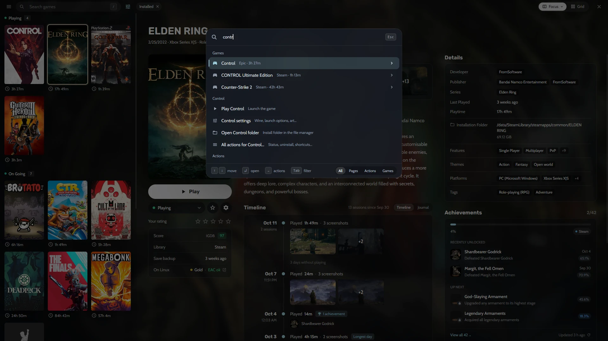

## Comment réunir tous mes jeux dans une Collection ?

- **Steam :** Heronite lit vos bibliothèques [Steam](/fr/features/stores/) sans connexion.
- **Epic Games, GOG et Amazon Games :** connectez-vous sur la page **Stores** ; Heronite ajoute toute votre bibliothèque, jeux installés ou non.
- **Battle.net, EA app, Ubisoft Connect et Rockstar Games :** les jeux installés dans chaque boutique apparaissent. Sur Linux, la boutique fonctionne dans son propre préfixe Wine (un dossier Windows séparé).
- **Microsoft Store et PC Game Pass (Windows) :** Heronite ajoute les jeux installés par l’application Xbox, sans connexion.
- **Émulateurs :** Heronite [les détecte](/fr/features/emulation/) et analyse vos dossiers de ROM.
- **Autres lanceurs :** jeux Heroic, Lutris, Bottles et Faugus sur Linux et Playnite sur Windows, importés et synchronisés.

## Comment ajouter un jeu qui ne vient pas d’une boutique ?

Appuyez sur <kbd>Ctrl</kbd> <kbd>N</kbd> (ou **Add a game**) pour ajouter :

- Un programme Windows (`.exe`), lancé via [Wine ou Proton](/fr/features/wine-and-proton/) sur Linux
- Un programme Linux natif, une AppImage ou un script de lancement
- Un jeu de navigateur, avec son adresse web
- Une ROM ou un dossier de ROM complet

Pour ajouter plusieurs jeux à la fois, choisissez **Add from folder** dans le menu ☰.

*Ajout d’un jeu Windows sur Linux.*

## Comment regrouper, filtrer et trier mes jeux ?

**Focus** est une liste avec un panneau de détails : jaquette, captures d’écran, description et historique des sessions. La **grille** affiche uniquement les jaquettes.

Dans les deux dispositions, regroupez les jeux par :

- Statut, comme Playing, On going, Plan to play ou Finished
- Boutique
- Genre
- Série
- Année de sortie ou autre champ

Enregistrez filtres et tri comme **vues**, par exemple *Playing now*, *Backlog*, *Finished* ou *Favourites*.

## Comment rechercher dans la Collection ?

Commencez à saisir du texte n’importe où dans la Collection. La recherche tolère les petites fautes ; <kbd>Entrée</kbd> lance ou installe le premier résultat.

La **palette de commandes** (<kbd>Ctrl</kbd> <kbd>K</kbd>) ouvre toute page, exécute toute action et lance tout jeu à partir d’une partie de son nom. Appuyez sur <kbd>→</kbd> sur un jeu pour accéder à ses actions, comme ouvrir ses réglages ou son dossier d’installation.

*Recherche de « contr » dans la palette de commandes.*

## Comment modifier plusieurs jeux à la fois ?

1. Sélectionnez les jeux avec <kbd>Espace</kbd>, <kbd>Maj</kbd> et les flèches, ou <kbd>Ctrl</kbd> <kbd>A</kbd>.
2. Appuyez sur <kbd>F3</kbd>.
3. Modifiez leur statut, genres, séries, entreprises et autres champs.

<kbd>Ctrl</kbd> <kbd>Z</kbd> annule la modification. Vous pouvez renommer et fusionner genres, entreprises et séries pour réunir, par exemple, *RPG* et *Role-playing (RPG)*.

## D’où viennent les jaquettes et les informations des jeux ?

Jaquettes, arrière-plans et logos proviennent des boutiques et des métadonnées Steam et Lutris, tout comme descriptions et dates de sortie. Deux clés gratuites facultatives ajoutent du contenu :

- [SteamGridDB](https://www.steamgriddb.com) pour les jaquettes communautaires, utiles aux jeux émulés et sans DRM
- [IGDB](https://www.igdb.com) pour les descriptions, genres et séries

Chaque jeu affiche les durées **How Long To Beat**, les notes **ProtonDB** sur Linux, l’**état de l’antitriche** d’Are We Anti-Cheat Yet? et les **succès** Steam et RetroAchievements. Ajoutez les clés dans **Settings → Metadata** ; voir [Métadonnées et illustrations](/fr/docs/metadata-and-art/).

## Puis-je prendre des notes sur un jeu ?

Oui. Chaque jeu dispose d’un **journal**, pour noter où vous en étiez ou votre avis sur une fin. Il partage un historique avec vos [sessions de jeu](/fr/features/play-time-tracking/) et vos captures d’écran.
