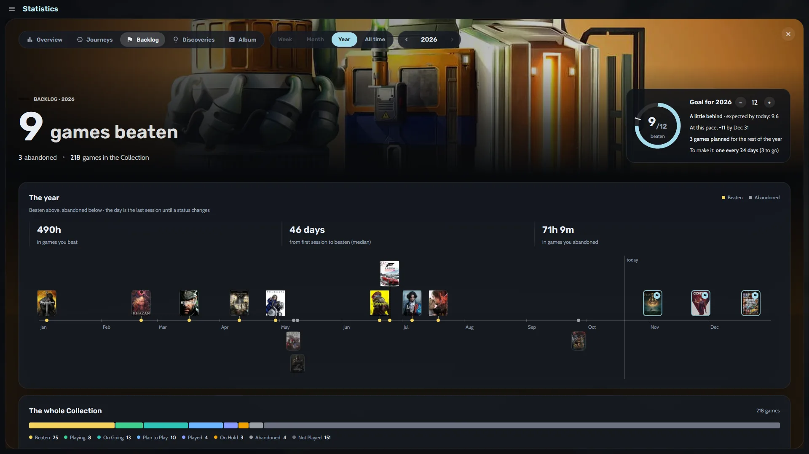
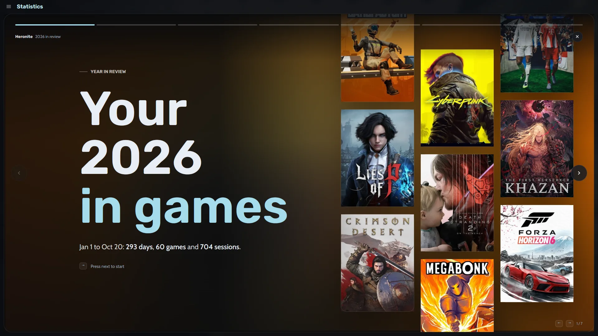
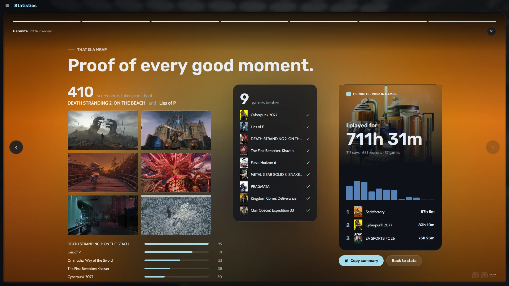

Le temps de jeu apparaît sous chaque jaquette, dans les détails du jeu, son historique et sa page en mode console.

Heronite enregistre tout sur votre PC dans des fichiers JSON, sans télémétrie. Pour en faire une copie, voir [Sauvegardes et copies de sécurité](/fr/features/saves-and-backups/).

## Où voir mes statistiques de jeu ?

Ouvrez **Statistics** avec <kbd>Ctrl</kbd> <kbd>6</kbd>. Choisissez **Week**, **Month**, **Year** ou **All time** en haut, puis les flèches pour changer de période. L’onglet **Overview** affiche :

- Le temps total, comparé à la période précédente
- Les jours joués, votre série de jours et le nombre de sessions
- Votre journée la plus chargée et vos jeux les plus joués
- Un **graphique quotidien** où chaque couleur correspond à un jeu

Les autres onglets :

- **Journeys** affiche l’évolution de vos jeux et ceux auxquels vous jouiez en parallèle.
- **Backlog** suit votre objectif et les jeux terminés.
- **Discoveries** relève des événements, comme reprendre un ancien jeu après des mois d’arrêt.
- **Album** rassemble vos captures d’écran.

## Comment fixer un objectif annuel de jeux à terminer ?

1. Ouvrez **Statistics** (<kbd>Ctrl</kbd> <kbd>6</kbd>), puis l’onglet **Backlog**.
2. Fixez votre objectif annuel avec les boutons moins et plus.

Un cercle de progression indique le nombre de jeux terminés, si vous êtes dans les temps et le rythme à tenir. Heronite compare vos heures aux durées **[How Long To Beat](https://howlongtobeat.com)**.

*L’onglet Backlog avec son cercle d’objectif et son historique de jeux terminés.*

Sous le cercle :

- Une frise annuelle, avec les jeux terminés au-dessus et abandonnés en dessous
- Les heures passées sur les jeux terminés et abandonnés
- Le nombre médian de jours entre la première session et la fin d’un jeu
- Votre liste Plan to play et le temps nécessaire à votre rythme habituel

## Comment ouvrir mon bilan annuel de jeu ?

Ouvrez la bannière de la page **Statistics**, ou appuyez sur <kbd>Ctrl</kbd> <kbd>K</kbd> et saisissez « Year in review ». Heronite présente votre année en **sept récits en plein écran**, en fin d’année ou à tout moment.

*Le premier récit, sur un mur de jaquettes.*

Les récits couvrent votre mois le plus actif, votre plus longue série, votre plus longue pause et votre jeu de l’année. Les derniers présentent vos horaires habituels, puis une synthèse. **Copy summary** copie un court texte sur votre année, à publier où vous voulez.

*Le dernier récit se termine par une carte de votre année, prête à partager.*

## Comment ajouter des notes et des captures à mon historique ?

Chaque jeu dispose d’un **journal** pour vos notes, par exemple où vous en étiez. Il partage le même historique que vos sessions.

Pour les captures, appuyez sur <kbd>F10</kbd> en jouant. Heronite associe la capture au jeu ; vous pouvez changer la touche dans **Settings → Screenshots**. L’onglet **Album** et la page de chaque jeu affichent vos captures.

Pour commencer : [téléchargez Heronite](/fr/download/).
