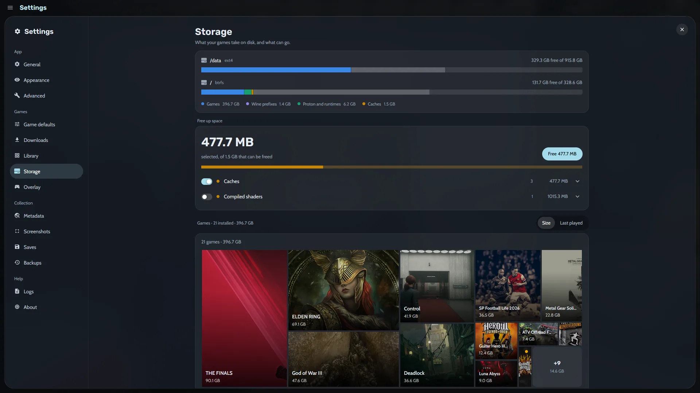
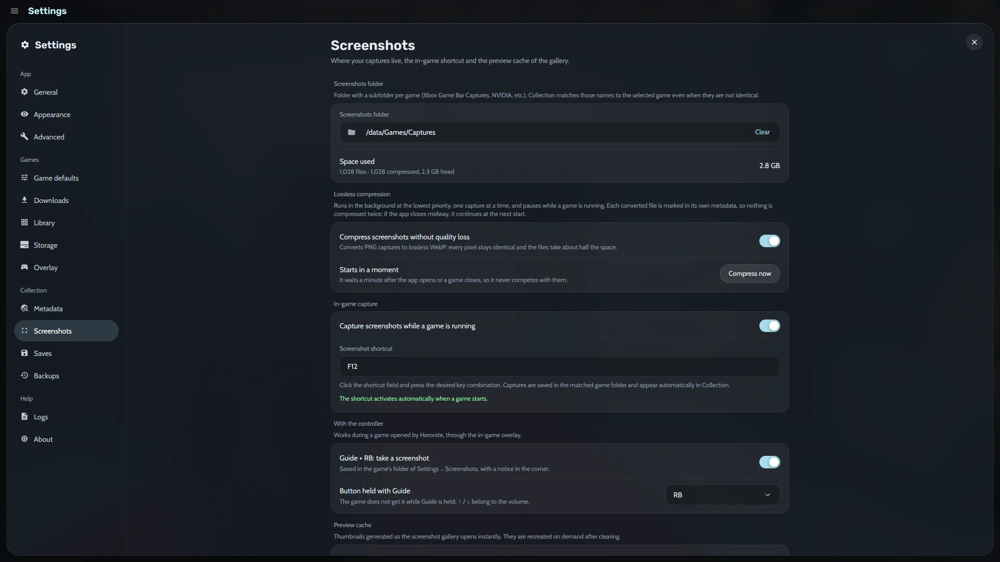

[Ludusavi](https://github.com/mtkennerly/ludusavi) est un programme gratuit qui connaît l’emplacement des sauvegardes de milliers de jeux : dossier Windows, Steam ou préfixe Wine (un dossier Windows séparé pour le jeu). Installez-le une fois ; Heronite copie les sauvegardes après chaque session.

## Comment installer Ludusavi pour Heronite ?

1. Installez Ludusavi depuis [ses versions](https://github.com/mtkennerly/ludusavi/releases/latest), votre distribution, winget ou Scoop.
2. Dans **Settings → Saves**, choisissez le dossier des copies et le nombre de copies complètes à conserver par jeu.

Sur Linux, Heronite cherche Ludusavi sur `PATH`, dans `/usr/bin`, `/usr/local/bin` et `~/.local/bin`. Ludusavi met à jour sa liste de jeux une fois par jour. Voir [Copies de sécurité et sauvegardes](/fr/docs/backups-and-saves/).

## Comment restaurer une sauvegarde de jeu ?

1. Fermez le jeu.
2. Ouvrez sa page et l’onglet **Saves**, qui répertorie ses copies.
3. Choisissez une copie et appuyez sur **Restore…**.
4. Choisissez les fichiers dans **Files to restore**, puis appuyez sur **Restore *n* files**.

En **mode console**, utilisez la ligne **Back up saves (Ludusavi)** de la page du jeu.

- Heronite conserve une copie des fichiers remplacés ; **Undo** les remet en place.
- Nommez une copie, par exemple « Avant le boss final », et **verrouillez-la** pour qu’Heronite ne la supprime jamais.
- Les jeux émulés peuvent reprendre depuis des [états de sauvegarde](/fr/features/emulation/).

## Heronite synchronise-t-il les sauvegardes cloud Epic et GOG ?

Oui, en bêta, sur Linux et Windows. Ouvrez **Game settings → Cloud saves** et appuyez sur **Sync**, ou activez **Sync automatically** pour synchroniser au lancement et à la fermeture du jeu. Faites une copie de vos sauvegardes avant la première synchronisation.

## Comment planifier les copies de toute ma Collection ?

1. Ouvrez **Settings → Backups**.
2. Choisissez un dossier de destination.
3. Choisissez **daily**, **weekly**, **monthly**, ou uniquement à l’appui sur **Back up now**.

Une copie protège vos statuts, notes, journal et [historique de jeu](/fr/features/play-time-tracking/). Heronite conserve par défaut les 10 copies les plus récentes.

Chaque copie est un dossier daté que vous pouvez parcourir. Les fichiers inchangés sont partagés avec la copie précédente : seule la partie modifiée prend de l’espace supplémentaire. Les copies planifiées s’exécutent quand Heronite est ouvert, jamais pendant une partie.

### Que contient une copie ?

| Partie | Contenu |
|---|---|
| Collection (toujours) | Jeux, sessions, statuts, journal et réglages par jeu |
| Settings | Apparence, thèmes du mode console et autres réglages |
| Art | Jaquettes et illustrations choisies |
| Logins | Connexions aux boutiques |

Les jeux installés, versions de Wine et Proton, caches et journaux techniques sont exclus : vous pouvez les télécharger à nouveau.

### Comment restaurer une copie de la Collection ?

1. Dans **Settings → Backups**, choisissez une copie pour voir son contenu.
2. Choisissez les parties à remettre en place.
3. Appuyez sur **Restore…**, puis **Restore and restart**.

Heronite copie d’abord l’état actuel pour permettre un retour en arrière. Voir [Fichiers et dossiers](/fr/docs/files-and-folders/).

## Puis-je garder la même bibliothèque sur plusieurs PC ?

Oui. **Settings → Cloud** synchronise statuts, favoris, notes, temps de jeu et sessions entre PC, par exemple entre Linux et Windows en double démarrage. Il utilise un dossier partagé ou un compte cloud comme Google Drive, Dropbox ou OneDrive.

Le même emplacement peut accueillir les copies Heronite, les sauvegardes Ludusavi et les captures. Voir [Synchronisation entre PC](/fr/docs/sync-between-pcs/).

## Où est passé mon espace disque ?

**Settings → Storage** affiche l’espace occupé par vos jeux sur chaque disque : jeux, préfixes Wine, Proton et environnements d’exécution, caches. Une **carte proportionnelle** représente chaque jeu installé par un bloc dont la taille reflète son espace disque. Triez par taille ou date de dernière partie.

*Les réglages Storage, avec la carte Free up space.*

**Free up space** liste les éléments supprimables, comme les caches et shaders compilés. Sur Linux, il détecte les préfixes Wine et versions de Proton inutilisés et les restes Steam de jeux désinstallés. Heronite met les préfixes et dossiers résiduels à la corbeille et refuse de supprimer les dossiers utilisés par un autre jeu.

## Comment gérer les captures et leur espace disque ?

Les captures sont placées dans le dossier choisi dans **Settings → Screenshots**, qui affiche leur taille. Une option compresse les PNG en WebP sans perte, conservant chaque pixel pour environ moitié moins d’espace. La compression s’interrompt pendant les parties.

*Les réglages Screenshots.*

Appuyez sur <kbd>F10</kbd> en jouant ; changez la touche dans ces mêmes réglages. À la manette, l’[interface en jeu](/fr/features/console-mode/) prend une capture avec Guide + RB. Heronite l’associe au jeu pour l’afficher dans vos [statistiques](/fr/features/play-time-tracking/) et votre journal.

Pour commencer : [téléchargez Heronite](/fr/download/).
