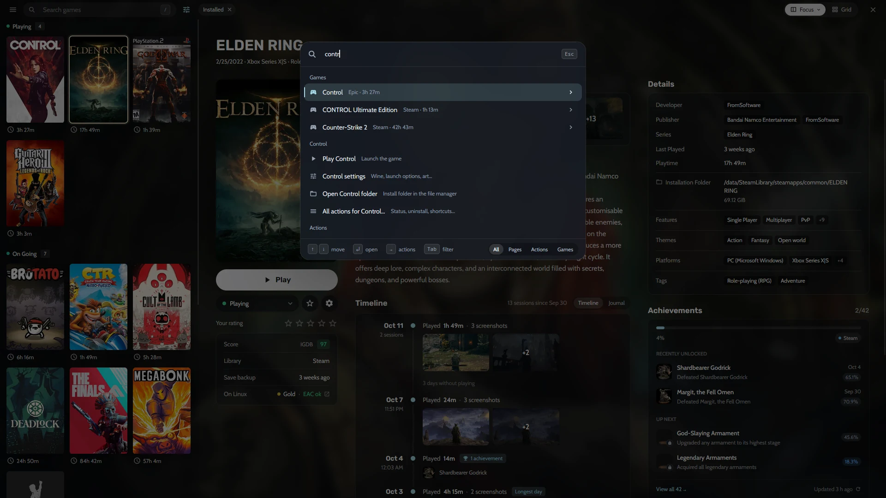

Most PC players end up with games spread over half a dozen launchers: Steam for most things, Epic for the weekly free games, GOG for DRM-free classics, Amazon for Prime Gaming, plus a folder of emulated games and a few odd installers. Heronite brings all of them into one place, called the **Collection**, and lets you organize it the way you think about your games, not the way each store does.

## One Collection for every store

Heronite reads your [Steam](/features/stores/) libraries by itself, no login needed. Log in to Epic Games, GOG or Amazon Games on the **Stores** page and their whole libraries come in too, installed or not. On Linux, the Battle.net, EA app, Ubisoft Connect and Rockstar Games clients each run in their own Wine prefix, and the games you install in them show up in the same list.

Emulated games join the same shelf. Heronite [detects your emulators](/features/emulation/) and scans your ROM folders, so a PlayStation 2 classic sits next to the latest Steam release with its own cover and play time.

And if you already use another launcher on Linux, you can bring its games in: Heronite imports and keeps in sync the games of Heroic, Lutris, Bottles and Faugus, and never writes to their files.

## Add any game, from anywhere

Not every game comes from a store. Press <kbd>Ctrl</kbd> <kbd>N</kbd> (or **Add a game**) to add:

- a Windows program (`.exe`), which on Linux runs through [Wine or Proton](/features/wine-and-proton/),
- a native Linux program, an AppImage or a start script,
- a browser game, by its web address,
- a ROM, or a whole ROM folder.

You can also point Heronite at a folder and add every game found in it at once, which is handy for a drive full of DRM-free installs.

*Adding a Windows game on Linux: art, platform, Wine prefix and Proton build in one dialog.*

## Organize it your way

The Collection has two layouts. **Focus** is a list with a large details panel: cover, screenshots, description, How Long To Beat times, achievements and a timeline of every time you played. The **grid** shows covers only, for when you just want to browse.

On either layout you can **group** games by:

- status (Playing, On going, Plan to play, Finished and more),
- store,
- genre,
- series,
- release year, and other fields.

Filters and sorting can be saved as **views**, such as *Playing now*, *Backlog*, *Finished* or *Favourites*, so the list you want is always one click away.

## Search that forgives typos

Start typing anywhere in the Collection and a search begins. It forgives small typos, so a slip of the finger still finds the game. Press <kbd>Enter</kbd> to play or install the first result.

For everything else there is the **command palette**. <kbd>Ctrl</kbd> <kbd>K</kbd> opens any page, runs any action and plays any game by typing part of its name. Press <kbd>→</kbd> on a game to see its actions, like opening its settings or its install folder.

*The command palette finds games, pages and actions from the keyboard.*

## Edit many games at once

Store data is not always right, and a large library makes fixing it one by one a chore. Select several games with <kbd>Space</kbd>, <kbd>Shift</kbd> + arrows or <kbd>Ctrl</kbd> <kbd>A</kbd>, then press <kbd>F3</kbd> to change their status, genres, series, companies and more in one go. <kbd>Ctrl</kbd> <kbd>Z</kbd> undoes it.

Genres, companies and series can also be renamed and merged across the whole Collection, so *RPG*, *Role-playing* and *Role-playing (RPG)* become one.

## Art and details filled in for you

Covers, backgrounds, logos, descriptions and release dates are filled in automatically from the stores, Steam and Lutris metadata. Two optional free keys make it even better: [SteamGridDB](https://www.steamgriddb.com) for community covers (great for emulated and DRM-free games) and [IGDB](https://www.igdb.com) for descriptions, genres and series. Each game also shows:

- **How Long To Beat** times,
- **ProtonDB** ratings on Linux, so you know how well a Windows game runs,
- **anti-cheat status** from Are We Anti-Cheat Yet?,
- **achievements** from Steam and RetroAchievements.

Read [Metadata and art](/docs/metadata-and-art/) to set up the keys.

## A journal for your play days

Every game has a **journal**: notes on your play days next to the screenshots you took. Write down where you left off, a boss strategy or what you thought of an ending. It sits on the same timeline as your [play sessions](/features/play-time-tracking/), so a year later you can see what you played, when and what you thought of it.
