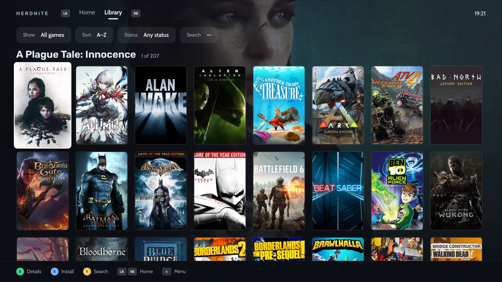
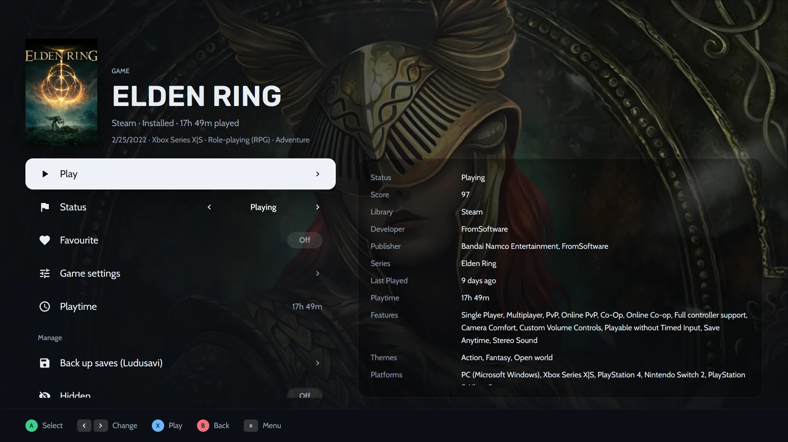

Uma biblioteca de jogos de PC é feita para o mouse. Uma TV não é. O modo console transforma o Heronite em um **launcher de jogos para o sofá**: capas grandes, uma coisa de cada vez em foco e cada ação em um botão do controle. A sua [Coleção](/pt-br/features/game-library/) inteira está lá, com todas as lojas, emuladores e jogos avulsos que você adicionou, então você não precisa de outro launcher para a sala.

## Como ligar o modo console?

Há três jeitos:

- Pela paleta de comandos (<kbd>Ctrl</kbd> <kbd>K</kbd>) ou pelo menu ☰.
- Iniciando o Heronite com `--console`, por exemplo em um atalho da Steam ou em uma sessão de jogo.
- Em **Configurações → Modo console**, fazendo-o abrir na inicialização ou quando um controle for conectado. Em cada caso você escolhe entre desligado, perguntar ou ligado.

Nada do modo console é carregado enquanto ele está desligado, então não custa nada no desktop.

> **Dica.** "Quando um controle for conectado" é ótimo para um PC embaixo da TV. Ligue o controle e o Heronite já estará no modo console quando você sentar.

## Botões do controle e do teclado

Tudo funciona com um gamepad. As dicas na parte de baixo de cada página seguem o seu controle, com imagens de botões de Xbox, PlayStation, Nintendo ou Steam Deck, ou você pode escolher à mão.

| Controle | Ação |
|---|---|
| A (sul) | Confirmar |
| B (leste) | Voltar |
| X, Y | Ações mostradas na tela |
| LB / RB | Trocar de aba |
| Direcional, analógico esquerdo | Mover |
| Analógico direito | Rolar |
| Start ou Guide | Menu |

Prefere o layout da Nintendo? Troque A e B nos controles do tema.

Sem gamepad por perto? O teclado faz o papel dele:

| Tecla | Funciona como |
|---|---|
| Setas | Mover |
| <kbd>Enter</kbd> ou <kbd>Espaço</kbd> | A |
| <kbd>Esc</kbd> ou <kbd>Backspace</kbd> | B |
| <kbd>X</kbd>, <kbd>Y</kbd> | X, Y |
| <kbd>Q</kbd> / <kbd>E</kbd> | LB / RB |
| <kbd>PgUp</kbd> / <kbd>PgDn</kbd> | Rolar |
| <kbd>M</kbd> ou <kbd>F1</kbd> | Start (menu) |
| <kbd>Tab</kbd> | Select |

## Navegue e jogue do sofá

A primeira aba costuma ser o **Início**: o jogo que você está prestes a continuar aparece grande sobre a arte dele, com prateleiras embaixo como *Continuar jogando* e *Favoritos*. Aperte A para abrir a página dele, X para jogar na hora e Y para pesquisar.

*A aba Biblioteca lista a Coleção inteira em capas, com filtros para o que mostrar, como ordenar e qual status.*

A página de um jogo mantém as ações em uma lista só: **Jogar**, **Status**, **Favorito**, **Configurações do jogo**, **Tempo de jogo** e, com o [Ludusavi](/pt-br/features/saves-and-backups/) instalado, uma linha **Fazer backup dos saves**. Detalhes como nota, desenvolvedora, série, último jogo e recursos ficam à direita.

*A página de um jogo no modo console: jogue, mude o status, abra as configurações ou faça backup dos saves, tudo com o controle.*

## Oito layouts, até quatro abas

Você não fica preso a um único visual. O modo console tem até **quatro abas**, e cada aba tem o seu próprio layout e os seus próprios jogos. Os layouts são:

- Prateleiras
- Vitrine
- Cinema
- Painel
- Grade
- Lista
- Carrossel
- Series X

Uma aba pode mostrar todos os jogos, só os instalados, os favoritos, um status, uma loja, uma plataforma e mais. Assim você pode ter uma aba *Início* com prateleiras, uma aba *Instalados* em grade e uma aba *Retrô* em lista para os seus jogos de emulador. Troque de aba com LB e RB.

As prateleiras podem mostrar jogos recentes, favoritos, jogos instalados, sugestões curtas do backlog e uma sugestão aleatória. O layout Painel pode mostrar a sua semana, downloads, uma sugestão do backlog, o seu diário e atalhos.

## Sete temas, e os seus próprios

Sete temas já vêm embutidos: **Minimal**, **Clássico**, **Cinema**, **Pulse**, **Fliperama**, **Central** e **Sala de estar**. Escolha um como ponto de partida e mude o que quiser, ao vivo do sofá ou em **Configurações → Modo console**:

- capas, formato e tamanho dos blocos,
- fundo, com a arte do jogo, uma capa desfocada, capturas de tela ou uma imagem sua,
- cor de destaque, fontes, tamanho da interface e do relógio,
- imagens dos botões,
- o menu (barra lateral, grade, dock ou trilho) e as páginas dos jogos.

### Compartilhe um tema

Exporte o seu tema para um arquivo `.heronite-theme.json` e importe em qualquer PC. A imagem de fundo vai dentro do arquivo, então um arquivo só basta para compartilhar. Você pode postar o seu nas [Discussions](https://github.com/RafaelGoulartB/Heronite/discussions) para outras pessoas experimentarem.

O arquivo é JSON puro e todos os campos são opcionais, então um arquivo curto também funciona. O [formato de tema](/pt-br/docs/console-theme-format/) lista todos os campos se você quiser editar um à mão.

## Teclado na tela e menu de energia

Sem teclado ao alcance, o modo console traz o seu próprio **teclado na tela** para digitar e um **menu de energia**, para você nunca precisar pegar o mouse. O botão Menu (Start ou Guide no controle, <kbd>M</kbd> ou <kbd>F1</kbd> no teclado) abre o menu principal em qualquer página.

## O modo console deixa o Heronite mais pesado?

Não. Ele faz parte do mesmo app nativo em Rust do launcher de desktop, que fica leve no seu PC, e nada do modo console é carregado enquanto ele está desligado.

## Dá para usar no Steam Deck?

Dá. O Heronite roda no Linux como AppImage, que é como os apps costumam ser instalados no modo desktop do SteamOS, e o modo console é feito para controles. Para usar pelo Modo Gaming, adicione o AppImage à Steam como jogo que não é da Steam, com a opção `--console`. O passo a passo está no [guia do Steam Deck](/pt-br/guides/steam-deck/).

## Overlay dentro do jogo e Replay (beta, Linux)

Com o overlay ligado, o botão Guide do controle abre um painel sobre o jogo com volume, microfone, limite de FPS, capturas de tela e anotações do diário.

| Botões | Ação |
|---|---|
| Guide | Abrir ou fechar o painel (<kbd>Super</kbd> <kbd>G</kbd> no teclado) |
| Guide + RB | Captura de tela |
| Guide + ↑ / ↓ | Volume |
| Guide + Y | Marcar um momento |
| Guide + X | Salvar o replay |

O **Replay** vem desligado por padrão. Quando ligado, ele guarda os últimos segundos de jogo, gravados na GPU pelo [gpu-screen-recorder](https://git.dec05eba.com/gpu-screen-recorder/about/).

> **Nota.** O overlay precisa de uma sessão Wayland cujo compositor suporte layer-shell, como KDE Plasma, Hyprland ou Sway. Ele não funciona no GNOME nem no X11.

## Mais na documentação

A página [Modo console](/pt-br/docs/console-mode/) lista cada botão, configuração e opção do overlay, e [Atalhos de teclado](/pt-br/docs/keyboard-shortcuts/) cobre o desktop. Ainda não instalou? [Baixe o Heronite](/pt-br/download/) para Linux ou Windows. É grátis e de código aberto.
