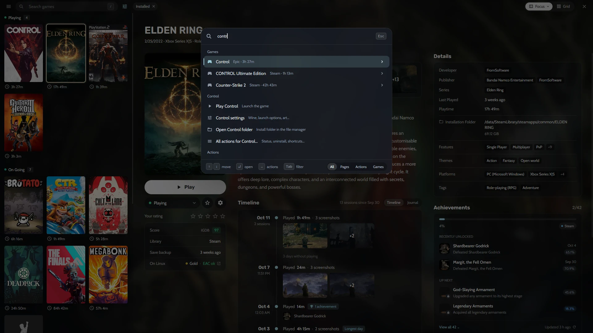

A maioria dos jogadores de PC acaba com jogos espalhados por meia dúzia de launchers: Steam para quase tudo, Epic para os jogos grátis da semana, GOG para clássicos sem DRM, Amazon para o Prime Gaming, mais uma pasta de jogos de emulador e alguns instaladores avulsos. O Heronite junta tudo em um lugar só, chamado **Coleção**, e deixa você organizar do jeito que pensa nos seus jogos, e não do jeito de cada loja.

## Uma biblioteca de jogos para todas as lojas

O Heronite lê as suas bibliotecas da [Steam](/pt-br/features/stores/) sozinho, sem pedir login. Entre na Epic Games, na GOG ou na Amazon Games na página **Lojas** e as bibliotecas inteiras também entram, instaladas ou não. No Linux, os clientes da Battle.net, EA app, Ubisoft Connect e Rockstar Games rodam cada um no seu próprio prefixo do Wine, e os jogos que você instala neles aparecem na mesma lista.

Os jogos de emulador entram na mesma estante. O Heronite [detecta seus emuladores](/pt-br/features/emulation/) e escaneia suas pastas de ROMs, então um clássico do PlayStation 2 fica ao lado do lançamento mais recente da Steam, com capa e tempo de jogo próprios.

E se você já usa outro launcher no Linux, dá para trazer os jogos dele: o Heronite importa e mantém sincronizados os jogos do Heroic, Lutris, Bottles e Faugus, e nunca escreve nos arquivos deles.

## Adicione qualquer jogo, de qualquer lugar

Nem todo jogo vem de uma loja. Aperte <kbd>Ctrl</kbd> <kbd>N</kbd> (ou **Adicionar um jogo**) para adicionar:

- um programa do Windows (`.exe`), que no Linux roda com [Wine ou Proton](/pt-br/features/wine-and-proton/),
- um programa nativo do Linux, um AppImage ou um script de início,
- um jogo de navegador, pelo endereço dele,
- uma ROM, ou uma pasta inteira de ROMs.

Você também pode apontar o Heronite para uma pasta e adicionar de uma vez todos os jogos que ela tiver, o que ajuda muito com um HD cheio de instalações sem DRM.

*Adicionando um jogo do Windows no Linux: arte, plataforma, prefixo Wine e versão do Proton em uma única janela.*

## Organize a biblioteca do seu jeito

A Coleção tem dois modos de exibição. O **Foco** é uma lista com um painel grande de detalhes: capa, capturas de tela, descrição, tempos do How Long To Beat, conquistas e uma linha do tempo de todas as vezes que você jogou. A **grade** mostra só as capas, para quando você quer apenas navegar.

Nos dois modos você pode **agrupar** os jogos por:

- status (Jogando, Em andamento, Planejo jogar, Finalizado e mais),
- loja,
- gênero,
- série,
- ano de lançamento e outros campos.

Filtros e ordenações podem ser salvos como **visões**, como *Jogando agora*, *Pendentes*, *Finalizados* ou *Favoritos*, e a lista que você quer fica sempre a um clique.

## Busca que perdoa erros de digitação

Comece a digitar em qualquer lugar da Coleção e a busca começa. Ela perdoa pequenos erros, então um deslize de dedo ainda acha o jogo. Aperte <kbd>Enter</kbd> para jogar ou instalar o primeiro resultado.

Para todo o resto existe a **paleta de comandos**. <kbd>Ctrl</kbd> <kbd>K</kbd> abre qualquer página, executa qualquer ação e inicia qualquer jogo se você digitar parte do nome. Aperte <kbd>→</kbd> sobre um jogo para ver as ações dele, como abrir as configurações ou a pasta de instalação.

*A paleta de comandos acha jogos, páginas e ações pelo teclado.*

## Edite vários jogos de uma vez

Os dados das lojas nem sempre estão certos, e corrigir um por um numa biblioteca grande dá trabalho. Selecione vários jogos com <kbd>Espaço</kbd>, <kbd>Shift</kbd> + setas ou <kbd>Ctrl</kbd> <kbd>A</kbd> e aperte <kbd>F3</kbd> para mudar status, gêneros, séries, empresas e mais de uma vez só. <kbd>Ctrl</kbd> <kbd>Z</kbd> desfaz.

Gêneros, empresas e séries também podem ser renomeados e unidos em toda a Coleção, e assim *RPG*, *Role-playing* e *Role-playing (RPG)* viram um só.

## Capas e detalhes preenchidos para você

Capas, fundos, logos, descrições e datas de lançamento são preenchidos automaticamente a partir das lojas e dos metadados da Steam e do Lutris. Duas chaves gratuitas e opcionais deixam tudo ainda melhor: o [SteamGridDB](https://www.steamgriddb.com) para capas da comunidade (ótimo para jogos de emulador e sem DRM) e o [IGDB](https://www.igdb.com) para descrições, gêneros e séries. Cada jogo também mostra:

- tempos do **How Long To Beat**,
- notas do **ProtonDB** no Linux, para você saber como um jogo do Windows roda,
- **status do anti-cheat** do Are We Anti-Cheat Yet?,
- **conquistas** da Steam e do RetroAchievements.

Leia [Metadados e imagens](/pt-br/docs/metadata-and-art/) para configurar as chaves.

## Um diário para os seus dias de jogo

Cada jogo tem um **diário**: anotações sobre os seus dias de jogo ao lado das capturas de tela que você fez. Anote onde parou, a estratégia de um chefe ou o que achou de um final. Ele fica na mesma linha do tempo das suas [sessões de jogo](/pt-br/features/play-time-tracking/), então um ano depois você vê o que jogou, quando e o que achou.
