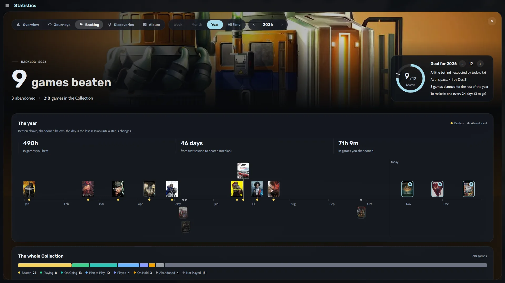
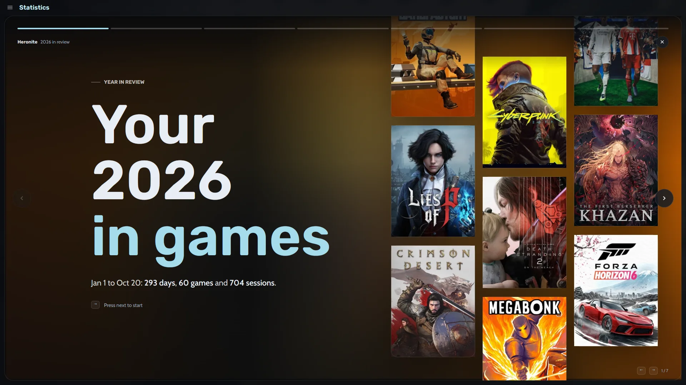
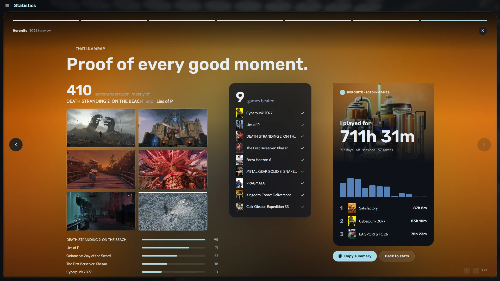

O tempo de jogo aparece embaixo de cada capa, nos detalhes do jogo, na linha do tempo dele e na página dele no modo console.

O Heronite salva tudo no seu PC como arquivos JSON simples, sem telemetria. Para fazer backup, veja [saves e backups](/pt-br/features/saves-and-backups/).

## Onde vejo minhas estatísticas de jogo?

Abra **Estatísticas** com <kbd>Ctrl</kbd> <kbd>6</kbd>. Escolha **Semana**, **Mês**, **Ano** ou **Todo o período** no topo e use as setas para mudar de período. A aba **Visão geral** mostra:

- O tempo total jogado, comparado com o período anterior
- Dias jogados, a sua sequência de jogo e o número de sessões
- O seu dia mais cheio e seus jogos mais jogados
- Um **gráfico dia a dia** em que cada cor é um jogo diferente

As outras abas:

- **Jornadas** mostra seus jogos ao longo do tempo e quais você jogou ao mesmo tempo.
- **Pendentes** acompanha a sua meta e os jogos que você zerou.
- **Descobertas** aponta coisas como voltar a um jogo antigo depois de meses longe.
- **Álbum** reúne as capturas de tela que você tirou.

## Como defino uma meta anual de backlog?

1. Abra **Estatísticas** (<kbd>Ctrl</kbd> <kbd>6</kbd>) e a aba **Pendentes**.
2. Defina uma meta para o ano com os botões de menos e de mais.

Um anel de progresso mostra quantos jogos você zerou, se está no caminho e que ritmo precisa ter. O Heronite compara as suas horas com o **[How Long To Beat](https://howlongtobeat.com)**.

*A aba Pendentes com o anel da meta e a linha do tempo dos jogos zerados.*

Abaixo do anel:

- Uma linha do tempo do ano, com jogos zerados acima da linha e abandonados abaixo
- As horas que você colocou nos jogos que zerou e nos que abandonou
- Quantos dias você leva da primeira sessão até zerar (a mediana)
- A sua fila de Planejo jogar e quanto tempo ela levaria no seu ritmo habitual

## Como abro a retrospectiva do meu ano de jogos?

Abra o banner da página **Estatísticas**, ou aperte <kbd>Ctrl</kbd> <kbd>K</kbd> e digite "Retrospectiva do ano". O Heronite mostra o seu ano em **sete stories de tela cheia**, no fim do ano ou a qualquer momento antes.

*O primeiro story, sobre um mural de capas.*

Os stories mostram o seu mês mais cheio, a maior sequência, a maior pausa e o jogo do ano. Os últimos mostram quando você costuma jogar e depois um encerramento. **Copiar resumo** copia um texto curto do seu ano para postar onde quiser.

*O último story termina com um cartão do seu ano, pronto para compartilhar.*

## Como adiciono anotações e capturas de tela ao meu histórico de jogo?

Cada jogo tem um **diário** para anotações, como onde você parou. Ele fica na mesma linha do tempo das suas sessões.

Para capturas de tela, aperte <kbd>F10</kbd> durante o jogo. O Heronite associa a captura ao jogo, e você pode mudar a tecla em **Configurações → Capturas de tela**. A aba **Álbum** e a página de cada jogo mostram o que você capturou.

Próximo: [baixe o Heronite](/pt-br/download/).
