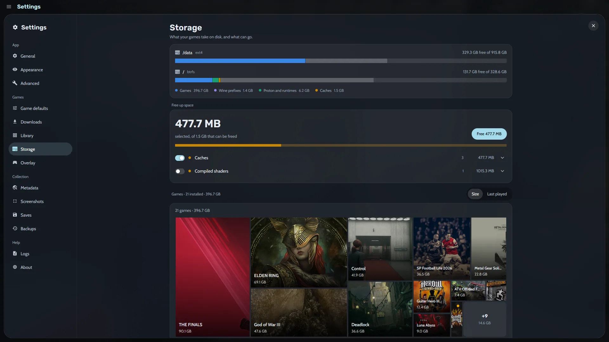
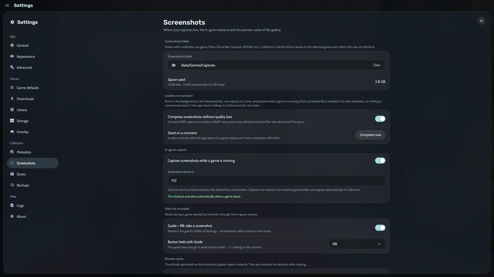

Perder um save dói. Uma reinstalação, uma atualização ruim ou um disco que falha podem levar junto 80 horas de progresso. O Heronite protege você de duas formas: ele faz backup dos **saves dos jogos** após cada sessão e faz backup da sua **Coleção** inteira em um horário agendado. Os dois rodam em silêncio, e os dois se restauram em poucos cliques.

## Como fazer backup dos saves dos jogos automaticamente?

O Heronite usa o [Ludusavi](https://github.com/mtkennerly/ludusavi), um programa gratuito que sabe onde milhares de jogos guardam os saves, seja em uma pasta do Windows, em uma pasta da Steam ou em um prefixo do Wine. Instale uma vez, e o Heronite faz backup dos saves de um jogo após cada sessão. Isso faz do Heronite um **frontend do Ludusavi**, sem comandos para digitar.

Instale o Ludusavi pelas [versões dele](https://github.com/mtkennerly/ludusavi/releases/latest), pela sua distribuição, pelo winget ou pelo Scoop. No Linux, o Heronite o procura no `PATH`, em `/usr/bin`, `/usr/local/bin` e `~/.local/bin`.

> **Dica.** As configurações de saves ficam em **Configurações → Saves**. Lá você escolhe para onde vão os backups e quantos backups completos são mantidos para cada jogo. O Ludusavi atualiza sozinho a lista de jogos uma vez por dia.

## Como restaurar o save de um jogo?

Abra a página do jogo. A aba **Saves** lista os backups desse jogo. Escolha um, selecione os arquivos a devolver e restaure. No **modo console** a mesma coisa é uma linha na página do jogo, **Fazer backup dos saves (Ludusavi)**, então dá para fazer do sofá com um controle.

Alguns detalhes deixam tudo mais seguro:

- Feche o jogo antes de restaurar um save.
- Uma cópia do que a restauração substituiu é guardada, e **Desfazer** a devolve.
- Você pode dar um nome a um backup, como "Antes do último chefe", e **travá-lo** para que nunca seja removido.
- No Linux, um save volta para o prefixo Wine do jogo como ele está agora, mesmo que o backup tenha sido feito no Windows ou em outra biblioteca da Steam.

Jogos de emulador também podem continuar dos seus save states. Veja [Emulação](/pt-br/features/emulation/).

## Backups agendados da Coleção

Os saves são só uma parte do que você odiaria perder. A sua Coleção também guarda seus status, notas, diário e [histórico de jogo](/pt-br/features/play-time-tracking/). Abra **Configurações → Backups** para protegê-la.

Escolha uma pasta e um agendamento: **todo dia**, **toda semana**, **todo mês** ou só quando você apertar **Fazer backup agora**. O Heronite mantém os 10 backups mais novos por padrão e remove os mais antigos.

Cada backup é uma pasta com data que você pode abrir e explorar. Os arquivos que não mudaram são compartilhados com o backup anterior, então um novo ocupa só o espaço do que mudou. Os backups agendados rodam enquanto o Heronite está aberto e nunca durante um jogo.

### O que vai dentro de um backup

| Parte | O que tem nela |
|---|---|
| Coleção (sempre) | Seus jogos, sessões, status, diário e configurações por jogo |
| Configurações | Aparência, temas do modo console e as outras configurações |
| Imagens | Capas e imagens que você escolheu |
| Logins | Os logins das suas lojas |

Versões do Wine e do Proton, caches e logs ficam de fora, porque podem ser baixados de novo.

### Restaure um backup

Escolha um backup para ver o que ele guarda e devolva tudo ou só uma parte. O Heronite antes faz backup do que você tem agora, para você poder voltar atrás. A restauração é aplicada quando o Heronite reinicia. A pasta precisa ficar fora da pasta de dados do Heronite, e outro disco ou uma pasta sincronizada é o melhor. Onde fica cada coisa está em [Arquivos e pastas](/pt-br/docs/files-and-folders/).

## Para onde foi o meu espaço em disco?

Jogos são grandes, e prefixos do Wine e caches se acumulam. A página **Armazenamento** nas Configurações mostra o que seus jogos ocupam em cada disco, com barras para os jogos, prefixos do Wine, Proton e runtimes, e caches. Abaixo disso, um **treemap** (mapa em blocos) desenha cada jogo instalado como um bloco com o tamanho do espaço que ele usa, então os maiores se destacam. Ordene por tamanho ou por quando você jogou pela última vez.

*Armazenamento: uso de disco, um cartão Liberar espaço e um treemap de todos os jogos instalados.*

**Liberar espaço** lista o que pode sair, como caches e shaders compilados. No Linux ele também pode achar prefixos do Wine e versões do Proton sem uso, e sobras da Steam de jogos que não estão mais instalados. Prefixos e pastas de sobras vão para a lixeira, de onde você pode restaurá-los, e o Heronite se recusa a remover pastas que outro jogo ainda usa.

## Capturas de tela: para onde vão e quanto espaço ocupam

As capturas de tela ficam em uma pasta que você escolhe em **Configurações → Capturas de tela**. A página mostra o espaço que elas usam, e uma chave pode compactar capturas em PNG para WebP sem perdas, que mantém cada pixel e ocupa cerca de metade do espaço. Isso roda em segundo plano e pausa enquanto um jogo está rodando.

*Configurações de Capturas de tela: a pasta, a compactação sem perdas, o atalho de captura e a captura com o controle.*

O Heronite tira uma captura de tela com <kbd>F10</kbd> enquanto você joga, e você pode mudar a tecla aqui. Com o controle, o [overlay dentro do jogo](/pt-br/features/console-mode/) tira uma com Guide + RB. As capturas são associadas ao jogo, então também aparecem nas suas [estatísticas](/pt-br/features/play-time-tracking/) e no diário.

## Mais na documentação

[Backups e saves](/pt-br/docs/backups-and-saves/) tem a lista completa de opções. Se algo não entrar no backup como esperado, veja [Solução de problemas](/pt-br/docs/troubleshooting/). [Baixe o Heronite](/pt-br/download/) para Linux ou Windows. É grátis e de código aberto.
