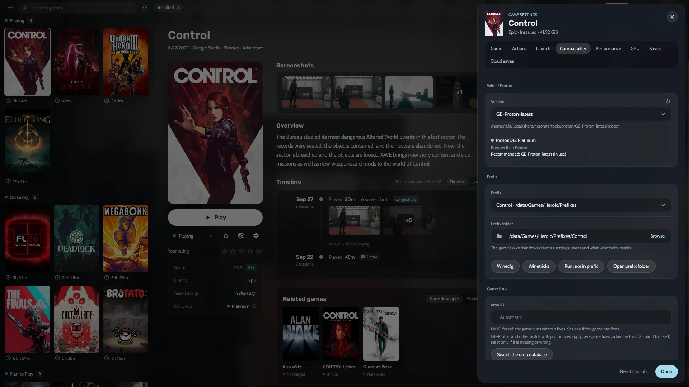

## Qué necesitas

- Un PC con Linux de 64 bits y un controlador de Vulkan que funcione. Ejecuta `vulkaninfo --summary` para comprobar que muestra tu GPU. Los juegos antiguos de 32 bits también necesitan el controlador de Vulkan de 32 bits.
- Una cuenta de Epic Games.
- Espacio libre en disco. Los juegos se instalan en `~/Games/Heronite` por defecto.

## Instala Heronite

Descarga el AppImage desde la [página de descarga](/es/download/):

```bash
chmod +x Heronite-x86_64.AppImage
./Heronite-x86_64.AppImage
```

Los paquetes para otras distribuciones están en la [guía de instalación](/es/docs/installation/). En la Steam Deck, sigue la [guía de Steam Deck](/es/guides/steam-deck/).

## Inicia sesión en Epic Games

1. Abre **Tiendas** (<kbd>Ctrl</kbd> <kbd>4</kbd>).
2. Elige **Epic Games**.
3. Haz clic en **Iniciar sesión**.
4. Inicia sesión en la página de Epic, en la ventana que se abre. Tu contraseña solo va a Epic.

Toda tu biblioteca de Epic aparece entonces en Heronite, esté instalada o no. Si la ventana de inicio de sesión no se abre, usa **O inicia sesión con tu navegador** en la misma página, como explica [Solución de problemas](/es/docs/troubleshooting/#falla-un-inicio-de-sesión-o-una-descarga-de-una-tienda).

## Reclama los juegos gratis de la semana

Heronite no reclama los juegos gratis de Epic, así que reclámalos en la web de Epic:

1. Abre la tienda de Epic en tu navegador e inicia sesión con la misma cuenta.
2. Reclama el juego gratis.
3. En Heronite, abre **Tiendas → Epic Games** y haz clic en **Actualizar biblioteca**.

El juego aparece entonces en tu biblioteca. Si falta, comprueba que usaste la misma cuenta de Epic y actualiza otra vez.

## Instala y juega a un juego de Epic

1. Mira el recuadro **En Linux** en los detalles del juego. Muestra la valoración de [ProtonDB](https://www.protondb.com) y el estado de anti-cheat. Un juego Gold o Platinum suele funcionar sin tocar nada.
2. Selecciona el juego y pulsa <kbd>Enter</kbd>, o elige **Instalar con Epic Games**.
3. Revisa la carpeta en **Seleccionar ruta de instalación**.
4. Confirma. La descarga aparece en la página Descargas (<kbd>Ctrl</kbd> <kbd>2</kbd>).
5. Cuando termine, selecciona el juego y pulsa <kbd>Enter</kbd> para jugar.

Cada juego tiene su propio prefijo de Wine (una carpeta que funciona como un Windows solo para ese juego). Si los archivos del juego ya están en el disco, elige **Importar juego** y selecciona la carpeta.

## Cambia la versión de Proton

Si el juego no abre o va mal, ve a **Ajustes del juego → Compatibilidad** y elige otra versión en **Versión**. La línea de ProtonDB de esa pestaña suele indicar la mejor. Para elegirla antes de instalar, abre **Mostrar ajustes de Wine** en el diálogo de instalación y cambia la **Versión de Wine**. Si no estás seguro, deja la de por defecto.



GE-Proton y Proton-CachyOS suelen traer correcciones antes que otras versiones. La [guía de GE-Proton](/es/guides/install-ge-proton/) explica cómo instalarlos.

## ¿Qué juegos de Epic bloquea el anti-cheat?

El anti-cheat es la razón principal por la que un juego online de Epic no funciona en Linux. Los juegos para un jugador rara vez tienen este problema.

- Algunos juegos con Easy Anti-Cheat o BattlEye funcionan. Activa el runtime correspondiente en **Runtimes de anti-cheat**, dentro de **Ajustes del juego → Compatibilidad**, y Heronite lo descarga antes del siguiente inicio.
- Los juegos cuyo desarrollador no permite Linux no funcionan.
- Fortnite no funciona. Epic no ha activado el soporte de Linux en su anti-cheat.

[Are We Anti-Cheat Yet?](https://areweanticheatyet.com) sigue el estado de cada juego. La documentación explica el [anti-cheat](/es/docs/wine-and-proton/#anticheat) con más detalle.

## Un juego de Epic no abre en Linux

Lee su log de inicio en **Ajustes → Logs**. [Solución de problemas](/es/docs/troubleshooting/#un-juego-no-abre-linux) cubre las DLL que faltan, DirectX 12 y los errores de Vulkan.
