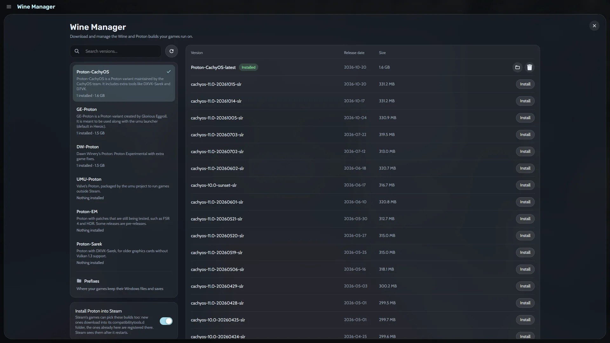

GE-Proton y Proton-CachyOS suelen traer antes las correcciones para los lanzamientos nuevos, así que pruébalos cuando un juego se cierre.

## Qué necesitas

- Heronite en Linux ([guía de instalación](/es/docs/installation/)). El Gestor de Wine no está en Windows. En Steam Deck, configura primero Heronite con la [guía de Steam Deck](/es/guides/steam-deck/).
- Conexión a internet. Las versiones se descargan de GitHub.
- Espacio en disco. Una versión de Proton ocupa desde unos cientos de megabytes hasta más de un gigabyte.

## Abre el Gestor de Wine

Pulsa <kbd>Ctrl</kbd> <kbd>3</kbd>, o ábrelo desde la paleta de comandos (<kbd>Ctrl</kbd> <kbd>K</kbd>). Elige una de las seis fuentes de la izquierda y sus versiones aparecen a la derecha, las más nuevas primero, con su fecha de publicación y su tamaño.

## Instala GE-Proton en el Gestor de Wine

1. Elige **GE-Proton** en la lista de la izquierda.
2. Busca la versión que quieras. **GE-Proton-latest** sigue la publicación más reciente. Una versión numerada se queda fija, lo cual sirve cuando un juego funciona solo con una publicación.
3. Haz clic en **Instalar**.

La fila cambia a **Instalado**. Las versiones van a `~/.local/share/heronite/tools/proton`. Usa el cuadro de búsqueda para encontrar una versión rápido.

> **Consejo.** Activa **Mantener actualizadas las versiones -latest**. Heronite actualiza entonces las entradas **-latest** en segundo plano, y nunca mientras se ejecuta un juego.

## Instala Proton-CachyOS

Elige **Proton-CachyOS** en la lista y haz clic en **Instalar** en una versión. Las versiones se instalan una junto a otra, así que puedes conservar las dos y cambiar por juego.

## ¿Para qué sirven las otras versiones de Proton?

| Fuente | Qué es |
|---|---|
| Proton-CachyOS | Una variante de Proton del equipo de CachyOS, con herramientas extra como DXVK-Sarek y D7VK |
| GE-Proton | Una variante de Proton de Glorious Eggroll, pensada para usarse con el launcher umu |
| DW-Proton | El Proton de Dawn Winery: Proton Experimental con correcciones extra para juegos |
| UMU-Proton | El Proton de Valve, empaquetado por el proyecto umu para ejecutar juegos fuera de Steam |
| Proton-EM | Proton con parches que aún se están probando, como FSR 4 y HDR. Algunas publicaciones son preliminares |
| Proton-Sarek | Proton con DXVK-Sarek, para tarjetas gráficas antiguas sin soporte de Vulkan 1.3 |

La página del juego en [ProtonDB](https://www.protondb.com) suele nombrar la versión que funciona.

## Elige una versión en Ajustes del juego

1. Selecciona el juego en tu Colección y abre sus **Ajustes del juego**.
2. Ve a la pestaña **Compatibilidad**.
3. En **Versión**, elige la que instalaste.

La misma pestaña muestra la valoración de ProtonDB del juego y una versión **Recomendado**. Tu elección se aplica solo a ese juego. Define una versión por defecto para los juegos nuevos en Ajustes. Mira [Wine y Proton](/es/docs/wine-and-proton/).

## Comparte las versiones con Steam (opcional)

Heronite puede poner versiones en la carpeta `compatibilitytools.d` de Steam, donde Steam puede usarlas:

1. En el Gestor de Wine, activa **Instalar Proton en Steam**.
2. Instala versiones como arriba. Las nuevas se descargan en `compatibilitytools.d`, y las que ya tienes se registran allí.
3. Reinicia Steam para que las vea.
4. En Steam, haz clic derecho en un juego, elige «Properties» (Propiedades), luego «Compatibility» (Compatibilidad), activa la opción de forzar una herramienta de compatibilidad y elige tu versión.

Heronite también encuentra las versiones de Proton que ya están en tus bibliotecas de Steam y los runners de Wine de Lutris, así que no las descargas dos veces.

## Actualiza y quita versiones

Junto a una versión instalada aparece **Actualizar** cuando hay una publicación nueva, y **Quitar** la borra. Los juegos configurados para usar una versión quitada pasan a la versión por defecto.

## Una versión no se instala, no aparece o no arregla el juego

- **La lista está vacía.** Haz clic en el icono de actualizar. Si dice que se alcanzó el límite de GitHub, vuelve a intentarlo después del tiempo que muestra.
- **Falla una descarga.** Comprueba tu conexión y haz clic otra vez en **Instalar**.
- **Steam no muestra la versión.** Asegúrate de que **Instalar Proton en Steam** estaba activado cuando la instalaste y reinicia Steam.
- **Un juego sigue cerrándose.** Prueba otra fuente, como Proton-CachyOS o DW-Proton, o un prefijo nuevo.

Para errores de Vulkan y otras correcciones habituales, mira [Solución de problemas](/es/docs/troubleshooting/#un-juego-no-arranca-linux). Si un juego tiene un anticheat que bloquea Linux, ninguna versión de Proton puede ayudar: mira [Anticheat](/es/docs/wine-and-proton/#anticheat).
